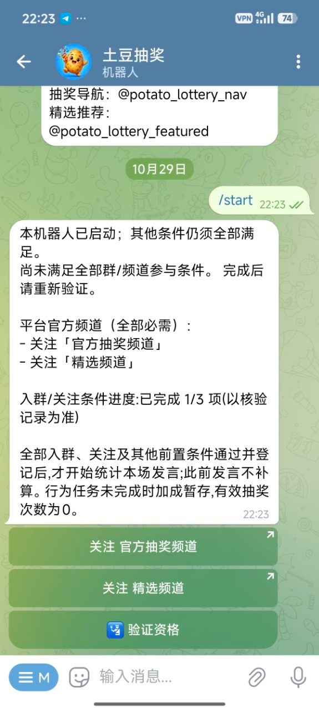
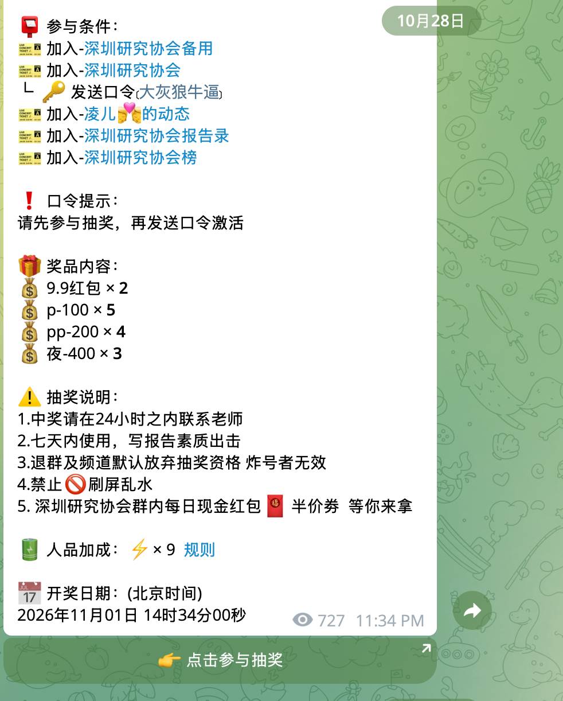
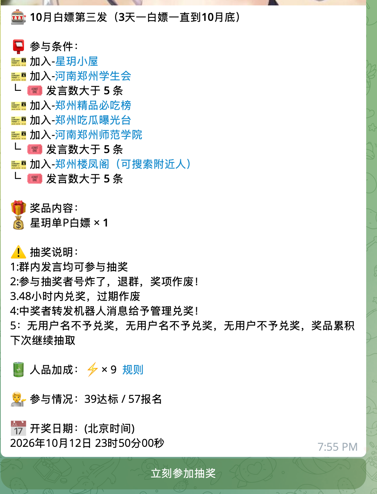
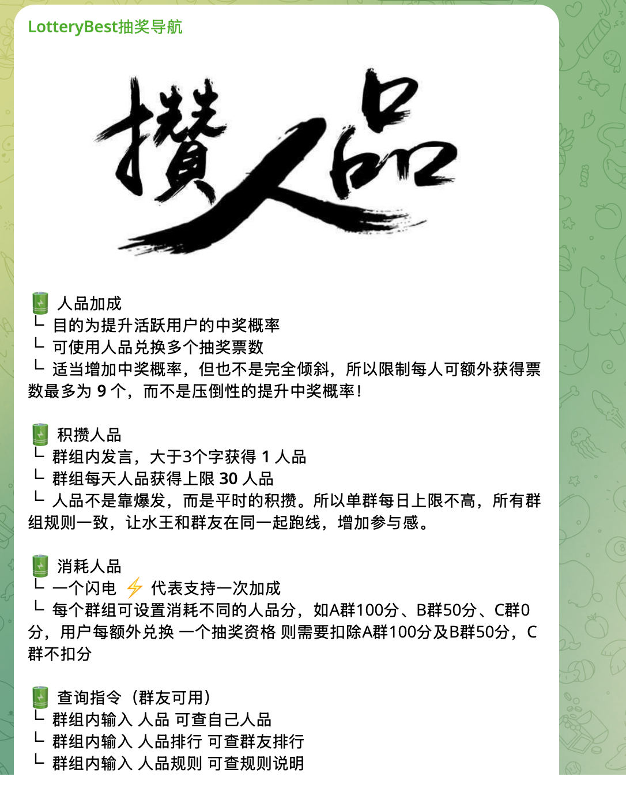
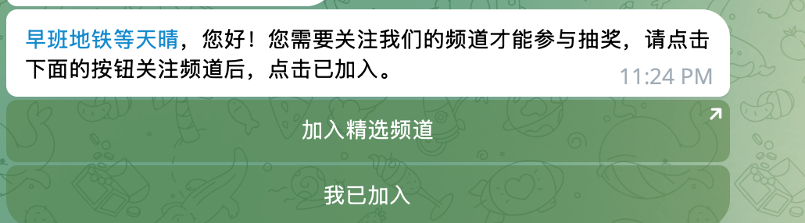
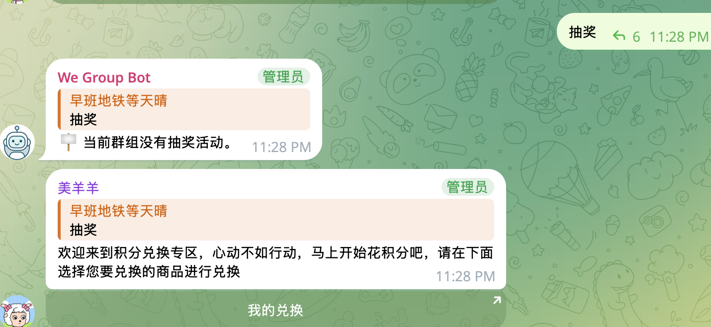
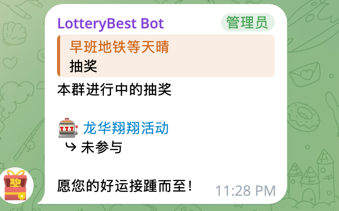
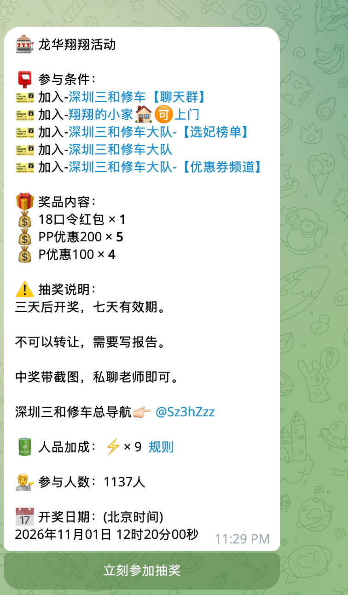

# 抽奖体验优化 PRD（R14 一致性复核稿）

日期：2026-10-29（北京时间）\
R14 修订更新：2026-10-30（北京时间）\
状态：R14本地实现已完成；独立审查后的三项修复已落地，本轮按用户要求暂未测试。此前自动化证据属于修复前快照；未发布，真实Telegram客户端验收仍待完成。\
范围：可编辑的默认抽奖说明、内容精简、自动删除、抽奖加成命名、条件状态、快捷参与、自有频道内个人交互、按钮布局及全界面表情文案；包含群内活动发现、本人进度命令、公共参与人数展示及定时完整开始卡。

本稿按用户最新说明收敛：用户必须先进入 Bot 私聊并明确点击报名按钮，才提交本场参与意向并触发报名资格核验；仅浏览公告、打开活动链接、启动 Bot、查看条件或刷新只读页面都不报名。前置资格通过后显示报名成功，后续发言/邀请门槛按原逻辑完成；已报名不等于最终有开奖资格。频道个人交互提供条件、关注和进度，首次报名统一进入 Bot 私聊完成。

本轮由用户授权补齐其余产品选择：默认短提醒 20 秒（可选 15 秒/关闭及更多时长）；抽奖加成为总入口，分发言抽奖加成、邀请抽奖加成；保留原公告转发能力，频道额外交互入口采用独立短消息；群内活动发现和公共人数纳入本稿。以上为 PRD 的明确方案，代码实施已获用户授权；生产发布未授权。

默认说明可由主办方任意编辑或清空，领奖后 7 天退群提示仅为文案；进度、计数、加成、准入、邀请归因和不可变开奖事实沿用原合同。与 R2～R13 草案冲突时以本稿为准；竞品截图用于展示参考，不能取代本项目业务规则。

> 下列R6～R14段落记录各次修订当时的状态；其中“仅PRD／未实现”不代表本轮实施现状。当前实现及逐项验证见[实施与验证记录](lottery-r14-implementation-20261030.md)。

R6 补齐活动状态对任务计数的限制、仅邀请门槛的入口、主动报名未完成后的恢复、频道辅助消息的发布目标，以及人数与指令的展示口径。报名仍必须由本人在 Bot 私聊明确点击，不改变 R5 已确定的参与流程。

R7 明确普通成员群内斜杠查询、中文别名、群命令菜单和蓝色正文活动链接；公共查询无需先报名或通过参与资格，点击链接进入 Bot 私聊查看后再明确报名。当前工作区群命令处理尚无此入口，群菜单仅注册 getid；本次仅补齐 PRD，不能报告功能已实现。

R8 增加[需求—代码—旧行为核对表](lottery-prd-feature-crosscheck-20261030.md)，逐项区分已有实现、本期缺口与对旧行为的改变。明确分享三条路径与固定入口，修正可能移除原公告按钮及破坏数字控件的表述。本轮属于文档核对，未修改业务代码；已写验收项不等于已完成该项功能。

R9 根据用户再次确认，明确区分“默认预填说明”与“默认短提示20秒删除”；报名在 Bot 内明确点击属于原有逻辑保留，不再列为本期报名规则变更。统一抽奖加成的两类完整名称，并同步修正旧行为核对表。

R10 用户补充：旧活动的进度短提示也纳入20秒删除；只处理更新后新发消息，更新前已经发出的进度提示放弃删除。按第5节时点边界和AC46验收，替代此前“旧活动进度提示保持原删除策略”的条款。

R11 新增第二个群查询入口：抽奖进度/发言进度/门槛进度及斜杠别名统一回复“📊 抽奖进度”，包含本人门槛、加成和邀请进度，并引用本人的请求消息。该类命令回复固定20秒删除，是“主动查询保留”的明确例外；活动发现列表与完整详情面板继续保留。本期仍只形成PRD，未实现命令代码。

R12纳入定时开始群消息，R13改为完整抽奖卡；R14保留首行“抽奖活动已经开始”、第二行普通文本“@全体成员”，之后复用原抽奖内容及按钮。撤回此前由口误推断的自动置顶要求，用户明确要求的是展示文本，不触发真实全体提及，不新增置顶操作。用户提及2026-10-30北京时间08:00场次仍是待核验具体场景，本轮未读取生产配置或判定消息实际结果。

R14 再审补齐：群公共列表与个人进度的边界、查询人身份与分页权限、删除分类优先级及并发保护、开始事件可靠性、完整卡示例和秒级时间；详见10.3。

### 本次两项默认值（分别设置）

| 默认项 | 新建活动初始值 | 主办方可调整内容 | 不产生的变更 |
| --- | --- | --- | --- |
| 📝 抽奖说明 | 预填第3节的编号说明文本，含领奖后7天提示 | 可以改写、增删或清空整段文字 | 不因改文字改变资格、任务或奖励执行规则，不新增领奖后监测和追回 |
| 🔔 独立短提示自动删除 | 发送确认后保留20秒再删除，默认开启 | 可选15秒、20秒、更多原有时长或关闭，按第5节设置 | 不删除任务面板、完整查询面板、公告、结果与领奖信息；指定进度命令回复按固定20秒例外处理，不删除业务记录 |

两项互不影响。说明清空不关闭自动删除；关闭自动删除不清空说明。说明不追改已有草稿/活动，复制保留已保存说明和显式设置；但更新生效后新发进度短提示统一受第5节新规则约束，旧活动不能沿用原“不删除”配置豁免。这里的“默认值修改”不指门槛、开奖时间、奖励倍数或报名方式。

## 1. 问题与依据

用户希望参与者一眼知道“还差什么、去哪里完成、是否已经报名”，减少长消息和重复操作。本轮查看用户截图、当前工作区源码及相关产品合同；没有登录生产机器人、发送 Telegram 消息或核验线上版本。工作区已有其他任务的修改，以下代码事实不能直接等同于生产事实。

### 1.1 截图观察

| 步骤 | 可见内容与状态 | 判断 |
| --- | --- | --- |
| 1 | 用户发送 `/start`，随后出现资格反馈 | 有明确反馈，但截图不能确定此前完整报名操作或对应活动 |
| 2 | 提示未满足条件，列出两个官方频道，进度为 1/3 | 能定位待关注对象，但未展示已完成的是哪一项，也未逐项明确打叉 |
| 3 | 两个关注按钮和一个验证按钮，每个独占一行 | 操作可发现；两项关注可并排，验证主操作保留独立行 |
| 4 | 用户关注后返回核验 | 截图未覆盖，实际刷新与报名结果未验证 |

图 1 的主要问题是重复解释多、状态与规则混排、按钮纵向占用大。长计数说明挤压即时操作；“已启动机器人”不等于报名成功，也不等于取得开奖资格。截图中的按钮本身已是纵向排列，因此不能据此认定全部页面都存在“4～5 个按钮挤在同一行”。后者按用户反馈列入全入口布局验收。

可访问性风险：只用颜色或图标难以理解；短时删除可能让阅读慢的用户来不及查看。设计要求状态图标带文字、重要信息可回查；读屏、字号放大、不同客户端截断尚未实测，不作合规认证。

### 1.2 现有能力核对

| 需求 | 当前工作区事实 | 本次应补齐 |
| --- | --- | --- |
| 抽奖说明 | 已有说明字段和“封面与说明”入口，新草稿默认空 | 默认注意事项、醒目的编辑入口、规则一致性 |
| 内容精简 | 已有扩展说明开关；参与入口仍可能逐条发送完整规则页 | 首屏摘要、规则按需查看、同一面板刷新 |
| 消息删除 | 已有完成提示删除选项，含 10/20/30 秒等；新草稿默认不删除。部分临时提醒固定 15 秒 | 新活动默认开启、增加 15 秒可选项；旧活动T后新发进度也删，T前已发放弃删除 |
| 条件打勾 | 已有成员条件进度，缺失条件页会过滤已满足目标；未完成部分使用空方框 | 所有个人入口统一 ✅/❌/⏳，显示门槛进度 |
| 快捷操作 | 已有缺失群/频道跳转与验证；活动链接支持分享 | 官方频道与活动条件统一展示，按钮随本人状态变化 |
| 按钮布局 | 已有公共样式与部分两列布局；缺失频道按钮目前逐行生成 | 明确逐页行列规则，覆盖 4～5 个操作的面板 |

证据入口：`creator_sections.py`、`draft_config.py`、`creator_messages.py`、`member_activity_landing.py`、`member_missing_targets.py`、`member_base_activity.py`、`application/participation_progress.py`、`application/message_deletion.py`。完整路径见文末。

### 1.3 七张竞品截图逐项对照

证据为用户本轮提供的截图，未操作竞品机器人。截图 3、6 可见 LotteryBest 名称；图 5 显示另外两个机器人，不能把七张图都认定为同一产品或同一连续流程。截图不能证明后台资格算法、自动删除效果、按钮点击后的实际结果，也不能证明个人临时响应已经使用。

| 图 | 可见设计与评价 | 本项目采用方式 | 不据此引入的规则/结论 |
| --- | --- | --- | --- |
| [竞品 1](assets/lottery-ux-prd-20261029/competitor-01.png) | 条件→奖品→说明→加成→开奖；群名可点；子条件缩进；说明有编号。结构清楚，但整体仍较长 | 保留固定分区和群名跳转；条件归属清楚；说明作为正文可见内容 | 不新增口令任务，不照搬奖品、宣传文字或领奖时限 |
| [竞品 2](assets/lottery-ux-prd-20261029/competitor-02.png) | 发言条件直接缩进在各群下；“39 达标 / 57 报名”区分状态；单一参与主按钮 | 分群门槛就近展示；人数若纳入需分清报名与当前达标 | 不照搬“大于 5 条”，本项目按实际配置显示“满 5 条”等；不引入未配置的用户名限制 |
| [竞品 3](assets/lottery-ux-prd-20261029/competitor-03.png) | 完整加成说明独立一页，按目的、获取、消耗、查询分节 | 公共卡只给加成摘要和规则入口，详细页按相同层次解释本项目规则 | 不复制永久人品积分、扣分兑换、每日 30 分、最多 9 票、字数限制等机制 |
| [竞品 4](assets/lottery-ux-prd-20261029/competitor-04.png) | 一段短提醒＋“加入精选频道”＋“我已加入”，下一步清楚 | 未满足关注时用短提醒，缺失频道直达，点击后重新核验；保留我们的总进度与逐项状态 | “我已加入”只是触发核验，不能按用户自述直接通过；截图没有显示完成后打勾的效果 |
| [竞品 5](assets/lottery-ux-prd-20261029/competitor-05.png) | 输入“抽奖”后两个机器人分别回复无活动和积分兑换；单条短，但多 Bot 响应容易混淆 | 空状态保持一句解释＋必要入口，不输出长帮助；避免无关兑换引导 | 不新增积分商城；不能仅凭截图断言“抽奖”是所有 Bot 的一致协议 |
| [竞品 6](assets/lottery-ux-prd-20261029/competitor-06.png) | 群内查询列出本群进行中的活动，活动名可点，下面显示“未参与” | 群公共列表展示活动和蓝色链接；本人的参与状态仅在个人页展示，综合进度命令按7.5.1明确例外公开回复本人摘要 | 图中未点击活动，不能认定点链接就自动报名；查询仍只读 |
| [竞品 7](assets/lottery-ux-prd-20261029/competitor-07.png) | 固定分区、自由长说明、参与人数、开奖时间、底部一个参与按钮 | 标准公告保留说明段落及主要信息，公共卡突出参与入口 | 不把参与人数等同于有效人数，不推断截图人数实时刷新；不复制其营销内容 |

从这些截图得到的调整重点是“固定层次、明确操作、信息就近”，不是一味缩短。竞品公告本身也很长：本项目应减少重复发送和重复解释，而不是把用户需要的说明、各群条件和进度隐藏掉。

### 1.4 对 R2 的具体纠正

- 公告不默认只剩“一句须知”：正常长度的主办方说明直接展示，超长时才有摘要和完整入口。
- 不把全部参与信息都塞在公告按钮里：公共卡以一个参与主操作为中心；两列布局主要用于个人面板和同级辅助操作。
- 加成文案用“摘要＋规则入口”，不直接模仿竞品的“⚡×9”造成次数上限或积分兑换误解。
- 对未完成关注者，主文案直接说“还需关注以下频道，完成后点击核验”，不重复启动成功、未满足条件、计数起点等整段解释；总进度和真实状态仍保留。
- 对已报名者继续保留本项目比截图更细的分群任务、加成差额及暂存信息。七张竞品图未展示这些完整进度，不意味着本项目应删掉它们。

## 2. 方案比较与本稿选择

| 方案 | 内容 | 适用场景 | 取舍 |
| --- | --- | --- | --- |
| A：原生消息统一优化 | 公共卡片保留活动摘要；私聊使用个人进度面板；每行最多两按钮；短提醒定时删除 | 不支持个人临时响应的环境、转发兼容入口 | 从频道进入私聊仍有一次跳转，不能单独满足本轮频道内交互需求 |
| B：频道/群内个人查看增强（本期方向） | 在支持的环境中，通过 Telegram 个人临时响应显示本人条件与操作，同时保留 A 的入口 | 在频道/群内查看本人条件、关注跳转与刷新进度；首次报名进入 Bot 私聊 | 需验证 Bot API、SDK、客户端和转发场景；离线接收无保证，仍需持久私聊入口 |

用户已明确要求平台支持就纳入支持，本期按 B＋A 兼容入口展开，不再将 B 列为可有可无的后续功能。Telegram 官方文档提供个人临时响应与替换显示能力，并说明可用于群或频道中的个人交互；但直接编辑普通公共消息会影响所有人，不可用来显示某一个人的资格。功能需求已纳入，实际 SDK、服务和客户端支持仍须验证，不等同于本项目已经实现。[个人临时消息说明](https://core.telegram.org/bots/features#ephemeral-messages)、[群与频道个人交互说明](https://core.telegram.org/bots/features#rich-messages)

## 3. 抽奖说明与默认注意事项

创建预览中直接显示“📝 抽奖说明”。新建草稿预填一段带编号的普通说明文本，主办方可直接增删、改写、重新编号或清空，包括修改下面的 7 天提示；不设不可编辑的系统条款，不新增强制条款确认流程。示例默认文案如下：

> 📋 参与须知\
> 1. 🎟️ 请先报名，并在截止前完成本场全部参与条件；未达门槛不能获得奖励。\
> 2. 👥 开奖时须仍满足本场入群及关注条件，退群或取消必需频道关注、资格复核未通过的，参与无效。\
> 3. 💬 前置条件通过且报名成功后，在本场允许的计数时段内统计任务，此前记录不补算。\
> 4. 🎁 中奖后请按领奖说明联系主办方领取奖励。\
> 5. 📌 领奖后 7 天内请勿退出本场要求加入的群；期间退群，主办方可收回奖励。

这是默认模板，不是按文案解析并执行的规则。实际门槛、截止、加成和开奖资格仍由结构化配置及原业务逻辑执行；修改或清空说明不会关闭核验，也不会新增任务。条件页继续显示真实配置，不能以自由文本替代真实条件。默认文案使用“本场任务”等通用措辞，避免给未配置的活动强加发言门槛。

用户已明确“领奖后 7 天”仅为说明文字：不新增领奖后退群监测、领奖前拦截、追回任务、扣款、奖励撤销状态或重新抽奖；不声称系统已经追回实物或转账。是否实际收回由主办方处理，机器人不保证能发现领奖后的退群。默认条款只写用户明确指定的退群，不擅自扩展成领奖后取消频道关注也自动追偿。已有开奖资格复核、邀请抽奖加成保留及最终开奖快照均沿用原合同。

新草稿仅在首次创建时预填默认说明；主办方保存的内容（包括主动清空）不能被返回、刷新、修改条件或恢复草稿覆盖。复制活动保留原说明，不擅自替换自定义文案或重复追加模板；已有草稿、已发布活动不批量补文案。清空后的活动不显示空的说明标题。预览、发布卡及详情使用同一份已保存说明；较长说明可在详情完整查看，不截断后丢失原文。继续按既有编辑权限及发布冻结合同处理。

说明支持原有文字、换行、普通表情和可安全呈现的链接，不在本期新增富文本编辑器。不自动重新编号、不改写主办方正文；按既有输入长度限制校验，超限或格式错误时保留原输入供修改，不静默裁切。预览提示“📝 说明为自定义文案，实际条件请核对上方配置”，用来解释自由文本与系统配置的区别，不新增内容审核或强制说明条款。

## 4. 页面内容与消息数量

### 4.1 公共活动卡

对照竞品 1、2、7，有两种排版方案：A 为标准分区公告，适合常见活动，说明和条件直接可见；B 为摘要卡＋完整详情，适合条件或说明超长的活动，但多一次查看。默认采用 A，仅超长时采用 B，不对所有活动强制折叠。

标准顺序为：封面/活动名称 → 📋 参与条件 → 🎁 奖品内容 → 📝 抽奖说明 → 🌱 抽奖加成摘要与规则链接 → 👥 参与情况 → ⏰ 截止和开奖时间 → 🎟️ 参与主按钮。群名可点击，其发言或邀请门槛缩进放在对应群下。各群分别达标；不能把 5 条/天、连续多天压成“发言 5 条”。参与情况按 7.6 展示，不新增未定义的“启用人数”开关。

如本场还配置用户名、区域或其他既有准入条件，也在参与条件区保留，不可用下面仅展示群/频道的示例代替全部真实条件。未开启加成时写“未开启”或隐藏空区，不能显示固定奖励承诺。

主办方正常长度的说明按保存内容保留编号、换行；超长才按段落摘要并标明“📖 查看完整说明”，不能截去关键退群/领奖条款而不告知。发送受文字/图片说明限制时沿用可靠的完整规则承载方式，不能只裁剪。参与条件、奖品及名额、报名截止和开奖时刻始终可获取，时间使用北京时间；主卡、开始卡及完整详情的截止/开奖时刻沿用原合同显示至秒，简短列表可以摘要展示但不能更改保存时刻。

完整规则、加成细则及超长说明由“抽奖详情”打开。公告不重复展示群内全部查询命令、删除策略、实现说明；完整冻结规则仍可查看，现有发布所需规则页及确认过程不因排版优化被取消。

标准卡文案结构示例（虚构活动，不代表系统已实现）：

> 🎁 周末福利抽奖\
> 📋 参与条件\
> 👥 加入 A 群\
> └ 💬 每天有效发言满 5 条，连续 2 天\
> 👥 加入 B 群\
> └ 💬 每天有效发言满 5 条，连续 2 天\
> 📡 关注官方抽奖频道、精选频道\
> 🎁 奖品内容\
> 礼品一 ×2；礼品二 ×3\
> 📝 抽奖说明\
> 1. 完成条件后参与开奖。\
> 2. 领奖后 7 天内退群，主办方可收回奖励。\
> 📈 抽奖加成\
> 🌱 发言抽奖加成：按本场规则 · 查看规则\
> 🤝 邀请抽奖加成：按本场规则 · 查看规则\
> 👥 参与情况：39人已记录达标 / 57人报名 · 截至11:30（北京时间）\
> ⏰ 报名截止：2026-11-01 19:55:00（北京时间）\
> 📅 开奖时间：2026-11-01 20:00:00（北京时间）\
> 🧑‍💼 发奖人员：本场已配置联系人\
> 🔗 点击参与

底部“🎟️ 参与抽奖”独占一行；现有适用的“邀请入口｜我的加成”保留在下一行，已配置的“一键加入群和频道”独占一行。仅调整排列和新命名，不因精简将原卡现有按钮移除；完整个人菜单仍在私聊，公共卡不额外搬入全部个人操作。

保留原公告合同的三项内容：正文可点击“🔗 点击参与”（与按钮为同一活动链接，保证只复制正文也有入口）；已配置的发奖人员/领奖联系人；历史已配置的“一键加入群和频道”群文件夹入口。领取分享卡、本人加成、邀请及记录入口可在个人面板或分享流程按原能力访问，不因公共卡精简被删除。私有目标在公开卡只链接到本活动条件入口，不暴露实际私有邀请地址。

“超长”按所用 Telegram 消息类型解析后的文字容量和既有预留判定，不按主观行数。有封面和无封面分别验证；优先保留条件、奖品、截止/开奖、发奖方和参与链接，主办方说明完整原文保存在详情。核心条件或奖品本身超长时按既有合同有序分页，主卡明确剩余数量及完整入口，奖品区不可消失，不裁切名称或链接。发布前预览展示实际摘要与分页效果；规则页未确认不视为发布完成。参见[现有公告长文合同](message-card-style-20261005.md)。

### 4.2 私聊个人面板

默认一条面板展示活动名称、本人状态、条件总进度、分群门槛、今日加成、有效/暂存次数和下一步操作。12 个逻辑行仅作为常见短页的排版目标，不是裁剪指标；信息放不下时分区或分页，不能为凑行数删掉进度。条件多时每页最多 6 项，明确总数、已完成数与剩余页数。

同一面板点“刷新进度”时原地更新；规则页采用按需分页，不再在每次进入或刷新时连续发送全部规则。首次登记前，必须看到关键条件和完整规则入口；“一键报名”是明确登记动作，打开详情、获取分享卡、仅关注频道不自动报名。

原面板不可编辑时明确提示并提供新入口，不掩盖失败。成功提示和面板不重复发送同一段全文；多项门槛/加成在同一条消息触发时合并短提醒。

### 4.3 示例文案（虚构进度，仅用于评审）

未完成关注时：

> 🎁 示例活动\
> 🎟️ 尚未报名 · 入群/关注 1/3\
> ✅ 已加入：活动群\
> ❌ 未关注：官方抽奖频道\
> ❌ 未关注：精选频道\
> 完成关注后，点击“核验并报名”。

该示例位于 Bot 私聊且尚未点击报名。按钮第一行“关注官方抽奖频道｜关注精选频道”；第二行“核验并报名”；第三行“刷新进度｜抽奖详情”。刷新仅只读核验条件；只有点击报名动作才提交意向并核验，成功才显示已报名；失败则更新为“报名待完成”。

已登记但尚未取得有效资格时：

> 🎁 示例活动\
> ✅ 已报名 · ❌ 门槛未全部达标\
> ✅ 入群/关注：3/3\
> ✅ A 群门槛：已完成\
> ❌ B 群门槛：今日 3/5 条，还差 2 条\
> 有效抽奖次数：0 · 暂存加成：2 次

按钮第一行“去 B 群完成”；第二行“刷新进度｜抽奖加成”；第三行“邀请好友｜抽奖详情”。仅当邀请门槛与邀请奖励均未启用时隐藏新邀请入口；只设置邀请门槛也必须保留完成任务的入口。超过最晚有效入群时间时改为“查看待核验邀请”，保留历史邀请记录。

全部达标时：

> 🎁 示例活动\
> ✅ 已报名 · ✅ 当前条件已达标\
> 有效抽奖次数：3（基础 1＋发言 2）\
> ⏰ 开奖时仍需通过资格复核。

以上数量仅为示例；实际次数取业务事实，不能在显示层自行补票。这些是状态区示例，不代表可以删除下方任务与加成区；完整面板按 4.4 展示。

### 4.4 原有进度保留清单（强制验收）

| 已有信息/逻辑 | 优化后的保留方式 |
| --- | --- |
| 入群/关注总进度及逐项结果 | 摘要始终显示已完成/总数；未完成逐项列出；已完成可展开查看，不删掉核验事实 |
| 各群发言门槛、今日条数/目标、剩余条数、连续达标天数 | 分群展示，群名仍可点击；连续多日规则不得变成单日规则 |
| 已完成本场门槛 | 保留完成状态，跨北京时间零点不因今日归零而失效 |
| 今日发言抽奖加成、当前轮进度、已完成轮数、再发几条增加几次 | 常用摘要保留每群今日奖励和下一轮差额；轮数、原始计数等在“📊 完整进度”可查 |
| 累计加成、基础次数、有效次数、暂存及失效原因 | 面板保留有效与暂存区别，详情可核对分项；历史奖励上限继续生效 |
| 邀请门槛、已确认/待核验人数、留存要求、分群邀请记录及链接 | 保留对应入口和进度；不把待核验当成达标，不改变活动与群归因 |
| 完成提醒、加成到账、全部门槛完成、截止未达标提醒 | 保留原触发条件及幂等，合并重复文字，不取消事件；短提醒删除后仍能查回进度 |
| 事件时间和完成当时次数 | 历史提醒与当前进度区分，不拿当前次数改写历史事件 |
| 已结束历史、开奖结果、中奖/未中奖状态、领奖说明 | 持续可回查，结果及领奖通知不因精简或关扩展提示消失 |

完整面板示例（虚构数据；本例未配置邀请门槛或邀请奖励，邀请区明确写未开启；配置时必须显示实际进度，群名实际带对应跳转链接）：

> 🎁 示例活动 · ✅ 已报名\
> 📡 入群/关注：3/3 已完成\
> 🚪 本场门槛\
> ✅ A 群：门槛已完成\
> ❌ B 群：今日 3/5 条，还差 2 条\
> 🌱 今日发言抽奖加成\
> A 群：已加 2 次 · 再发 5 条 +1 次\
> B 群：已加 0 次 · 再发 2 条 +1 次\
> 🤝 邀请抽奖加成：未开启；邀请门槛：未配置\
> 🎟️ 有效 0 次 · 发言抽奖加成 2 次暂存\
> 📌 各群门槛全部达标后生效。

按钮保留“📊 完整进度”“🔄 刷新进度”，根据状态提供去群完成、抽奖加成、邀请记录及详情入口；过多操作按层级组织，不能通过移除功能凑成三行。功能文案与表情规范见 8.1。

### 4.5 分享、转发与个人邀请入口（原能力保留）

“分享”不是一个含糊的通用按钮，下列路径全部保留并分别验收：

| 路径 | 固定可发现入口与行为 | 原有边界 |
| --- | --- | --- |
| 获取活动分享卡 | 未报名活动详情和已报名个人详情都有“🔗 分享活动”，进入分享页获取发送到本人私聊的同款活动卡 | 不要求先成功报名，不登记、不加票；按原开放活动分享校验 |
| 选择群/频道分享 | 分享页或提交分享卡后的提示保留“📤 分享到群或频道”，由用户选择目标并点选卡片发送 | 不改为机器人自动向所选群/频道广播；目标选择器原范围为群和频道，好友邀请另走个人邀请页 |
| 长按转发 | 本人收到的分享卡及可转发原公告均保留正文与URL参与按钮，转发后指向同一活动 | 受客户端及目标内容保护影响，不能把复制文字当作整卡转发验收 |
| 个人邀请转发好友 | 本场对应群邀请页保留“复制邀请链接”“打开邀请入口”“转发给好友/转发邀请”，以及分群邀请记录入口 | 保留真实个人/群/活动归因和资格检查，不用通用活动链接替换个人邀请链接 |

普通活动宣传卡不自动带上分享者个人邀请归因，不能因“保留邀请归因”这句总要求给每次活动转发新增邀请奖励。用户选择个人邀请链接时才使用原个人邀请路线；普通宣传中的“邀请入口”用于进入相应个人邀请流程。活动链接和邀请链接是不同业务入口，不能合并成一条以节省按钮。

分享入口不因未开启发言/邀请奖励被隐藏；个人邀请入口按门槛/奖励适用性及有效窗口展示。群查询公开列表以蓝色活动名进入详情即可，不强制每条活动多放分享按钮；用户进入详情后能找到分享操作。

私聊卡Outbox只确认机器人向本人发送的结果，不证明用户已经选择群/频道或真正转发。分享提示写“已提交发送”或确认后“分享卡已发送”，不能写“已分享到目标群”而无目标发送事实。内联模式不可用或选择器失败时，明确说明并保留本人卡片长按转发路径，不将失败静默当成成功。未启动/屏蔽/内容保护与网络错误按原机制反馈。

截止后不新建“仍可报名”的宣传卡；旧排队卡投递时按原合同显示最新状态和规则/结果入口。已发出的旧转发副本不批量重写。验证同时覆盖：未报名者获取卡、已报名者获取卡、群/频道选择器、长按转发、个人邀请转发、原卡与正文链接、截止、重复请求与失败。现有代码及历史验收状态见[核对表第1节](lottery-prd-feature-crosscheck-20261030.md)。

### 4.6 相邻旧功能保护

本次只覆盖明确修改项；未覆盖的现行合同继续有效，不因换版 PRD 被取消：草稿24小时保留、封面上传/替换/完成/清除、创建字段保存/取消/返回、群选择搜索分页、复制及旧面板版本保护；未报名提醒的原触发条件、首次/冷却与去重；两官方频道与启动Bot的活动冻结策略；逐群行为门槛、发言与邀请独立加成、24小时有效邀请核验与同群同人一次、历史奖励上限；开奖群公告、中奖私信及创建者通知分别投递，必要结果通知不随扩展提示关闭；用户ID提及、北京时间、同场结果回查和不可变开奖事实。

除第5节明确的新旧活动进度提示删除策略外，不因为提醒消息消失就重新获得触发资格，也不因为纯查询换名字就改变消息计数排除规则。已有数据、邀请归因及后台隔离运维路径不由本次展示改版重算或扩权。完整的改变旧行为清单见[核对报告第3节](lottery-prd-feature-crosscheck-20261030.md)。

## 5. 消息自动删除

设置入口：“消息设置 → 临时提示自动删除”。新活动独立短提示默认20秒删除，可选15秒、20秒、更多原有时长或关闭。**旧抽奖活动后续新发的进度短提示也必须纳入默认20秒删除，不能以旧活动、旧规则版本或旧配置为“不删除”为由继续保留。** 抽奖说明、行为门槛、票数、邀请核验及开奖规则不因此追改。

用户已明确以“更新时消息是否已经发出”为边界，实施时记录本次删除规则的生效时点 T（运维证据保存UTC，页面需要时显示北京时间）。T按本次策略启用版本持久化，所有发送/删除Worker共用，不因重启、重试或再次部署重设；发布切换需保证新发送均能登记适用删除策略，不能让旧Worker在T后继续按旧保留设置漏建任务。具体消息边界如下：

| 进度提示状态 | 删除规则 |
| --- | --- |
| T之前已经发出，包含本来有删除任务但尚未执行的消息 | 放弃删除；不新建、补执行或重试这条旧进度提示的删除，未执行任务取消/跳过并保留原因记录；不将放弃写成删除成功 |
| T之前创建/排队，但T时尚未发出，T之后才实际发出 | 按新提示处理，发送确认后默认20秒删除；不因载荷来自旧活动或旧队列而跳过 |
| T及之后新发出，属于旧活动 | 自动进度短提示默认20秒删除，旧“保留/不删除”等配置不构成豁免 |
| T及之后新发出，属于新活动 | 按当前活动明确设置删除，默认20秒；可由主办方按本节允许的设置调整 |
| 发送结果未知或实际发送时刻无法确认 | 保留未知与异常，不猜消息编号或重发；核对确认为T之前则放弃删除，确认为T之后则按新规则补齐删除任务 |

“已发出”以可核实的 Telegram 消息身份及发送事实判定，不能把入队时刻当成发出时刻；跨T的在途发送要核对实际发送时刻，不能仅因回执晚回来就误删旧消息。生效前已经完成的远端删除不回滚、不重发消息，已在途删除需保留实际结果，不能伪造为未执行。

新建/复制草稿的独立短提示设置仍由创建者在发布前选择；本期不新增发布后设置页。原有其他时长保留在“更多时长”。说明模板及其他设置的历史兼容继续生效，但**旧活动更新后新发进度提示20秒删除**是本次明确覆盖条款，属于消息保留策略调整，不能被“历史冻结”总则抵消。旧活动其他非进度提示是否删除继续原合同，不扩大成全聊天清理。原“扩展说明”与“删除报名命令”开关独立。

| 消息类型 | 首版默认行为 |
| --- | --- |
| 自动任务进度短提示：门槛推进/完成、发言抽奖加成、邀请核验/到账、全部达标及截止未达标等既有进度事件 | T之后新发，旧活动默认20秒删除；新活动默认20秒并遵循当前明确设置；T之前已发一律放弃删除 |
| 机器人独立发送的报名成功短回执 | 新活动按当前设置删除；旧活动非进度回执继续原合同，不借本条扩大删除范围 |
| 群内未报名提醒等非进度类既有临时提示 | 新活动纳入同一设置；旧活动这类消息继续原策略，与进度提示的T边界分开 |
| 带待办条件、关注入口的个人面板；完整规则；报名失败与核验异常 | 保留，方便继续完成或重试 |
| 抽奖进度/发言进度/门槛进度及 /progress 等等价命令触发的独立进度回复 | 群内和私聊统一在发送确认后20秒删除，含分页、空结果和失败反馈；不受单场活动的关闭/其他时长设置影响；用户原命令不随回复删除 |
| 按钮主动打开的完整进度面板，及其他加成、邀请、排行与记录结果 | 保留；上行指定的进度命令回复除外，不再笼统写所有主动查询都保留 |
| 公共活动公告、开始公告、转发分享卡、开奖结果、中奖私信、领奖说明 | 保留，不纳入自动删除；开始公告不因含“开始计数”字样归入20秒进度短提示 |
| 频道/群内个人临时响应 | 遵守平台生命周期，不把其消失当成业务数据删除；始终可从活动卡重开，持久私聊详情仍可回查 |
| 用户自己的报名命令或其他消息 | 不随本开关删除；已有“删除报名命令”作为独立设置保留 |

删除分类优先级固定为：先判定T前旧进度提示放弃删除；再保护公告/开始卡/结果/领奖及完整操作面板；再处理指定进度命令回复固定20秒；最后应用新旧活动自动短提示策略。指定进度命令的空结果、失败、限频反馈虽有错误文字，仍属于该命令回复，不能被“核验异常保留”误覆盖。旧活动T后自动进度短提示统一20秒，覆盖旧15秒、其他时长及不删除设置；新活动自动短提示沿用本场显式设置。

同一条消息如果既包含成功反馈又承载后续操作面板，按面板处理，不定时删除。按钮点击产生的短浮层反馈不再配套发送重复短消息。

7.5.1的进度命令回复仅承载摘要、查询分页及完整详情链接，带这些按钮仍固定20秒删除；点击后打开的完整详情使用独立面板并保留。不得在这条短回复中切换成报名或领奖面板，从而被旧删除任务误删。进度命令回复翻页/刷新不重置原20秒倒计时；消失后可重新发送命令，产生新的回复与删除任务。旧消息按T边界不补删，查询数据与用户命令本身不删除。

短提醒即使带“查看进度”按钮仍按短提醒处理，但必须能从长期保留的活动入口查回；有关注、报名或待完成任务操作的面板则保留。两个入口不得只凭“有没有按钮”判断是否删除。限期未达标的独立短提醒可按同一设置删除，完整失败原因在详情保留；不新增长期自动推送或另一个删除开关。

时间从确认发送成功开始计算；15/20 秒为目标保留时长，网络或 Telegram 限流可能延迟执行。删除依据明确的聊天与消息编号，任务可恢复、幂等；未知投递不得猜测编号，不回放旧消息。更新后新进度提示必须有可恢复的删除任务；可重试失败和限流按原重试策略继续处理，权限不足等持续失败明确告警，不静默放弃。删除失败不撤销报名、不显示已删除，保留可诊断记录；消息已经不存在与权限不足分开处理。

持久操作面板与可删除短提示原则上使用不同消息，防止“删除已经在途，消息刚改成结果面板”的竞争。必须复用时，转换与删除执行需共享消息类别/版本的互斥校验；无法确认删除未发出时另建持久面板，不在原消息上转换。不能只在数据库取消任务就宣称能阻止已发出的远端删除。进度命令的失败反馈仍按上一段固定20秒例外处理。若重启后任务已过执行时间，先核对T边界，T之前已发的旧进度提示跳过；其他允许删除的提示核实身份、类别及平台允许范围后补执行，不重发原提醒，不追删整个聊天历史。权限检查针对各目标聊天，不能用一个群的权限保证所有群可删除。

删除权限依聊天类型而异，不能保证所有群/频道消息都可删。实施前检查并在设置页显示权限问题，遵循 [Telegram deleteMessage 限制](https://core.telegram.org/bots/api#deletemessage)。不删除数据库业务记录、投递事实和审计记录。

## 6. 抽奖加成分类与统一命名

按用户给出的两类定义产品结构，不再使用“人品/活跃”混合标签，也不凭旧界面的词语推定两个概念可以随意合并：

| 层级 | 本稿统一显示名称 | 含义 |
| --- | --- | --- |
| 总入口/总模块 | 📈 抽奖加成 | 展示本场两种加成来源、状态及明细入口 |
| 分项一 | 🌱 发言抽奖加成 | 按本场有效发言规则增加抽奖次数；用户认可的“活跃抽奖加成”为这项的备选名称，本稿统一使用“发言抽奖加成”，同一版界面不混用 |
| 分项二 | 🤝 邀请抽奖加成 | 按本场有效邀请规则增加抽奖次数，与发言分项独立设置与展示 |

创建器、公告、规则、提醒、个人页、查询和帮助都使用上述完整名称，不能在其他页又缩成“人品加成”“活跃加成”或无归属的“邀请加成”。“抽奖加成”总入口有两个分项，但不要求两项都开启：未开启项明确标识；只有邀请门槛而无邀请奖励时提供“邀请门槛与进度”，不虚构奖励模块已开启。

历史“人品/人品排行/人品规则”指令继续按原群、原活动、原统计范围返回原数据，不因新分类合并账本、加上邀请次数或改成跨群排名。它们是旧入口兼容，不是新界面的第三类加成。新“抽奖加成”查询展示两种来源，“发言抽奖加成排行”保持原发言入账口径，不混入邀请。群内多场活动仍选择具体活动；查询不报名。

详细规则分为“🎟️ 加成用途 → 🌱 发言抽奖加成 → 🤝 邀请抽奖加成 → 📊 查询进度”，读取本场实际配置。加成表示增加本场抽奖次数，不保证中奖，不新增永久积分、兑换、扣分或第三类奖励。两种加成的门槛、统计周期、奖励、历史上限、累计、留存、去重、暂存与生效全部按原合同，不因名称调整改变。

## 7. 条件状态与快捷参与

### 7.1 状态合同

| 状态 | 展示 | 操作 |
| --- | --- | --- |
| 明确满足 | ✅ 已关注/已加入/门槛已完成 | 正文打勾，移除重复关注按钮；完成项可折叠为数量摘要 |
| 明确未满足 | ❌ 未关注/未加入/未达标，并列差额 | 给对应群/频道跳转或任务入口 |
| 无核验结果、网络失败、权限不足 | ⏳ 待核验或暂时无法核验，给原因 | 刷新/重试，不用红叉冒充明确未满足 |
| 入群申请待批 | ⏳ 等待管理员批准 | 不显示加入成功，不要求重复申请 |
| 已截止/开奖/取消 | 明确结束状态 | 停止报名和新增加成引导，保留规则/历史/结果 |

点击“关注”只打开频道，用户仍需在 Telegram 中自行关注，不能替用户执行关注；返回后刷新或点击一键报名重新核验。发言任务只引导去对应群，不代发消息。

门槛显示以本场完成事实为准：历史已完成不能因今日计数归零重新打叉；每日发言抽奖加成进度独立显示。连续多天门槛需显示达标天数，邀请门槛只计算已核验的有效邀请，不把待满留存时间者算作已完成。

每日可重复获取的加成不能永久打勾：本轮完成时显示到账，开始下一轮后显示新进度；达到历史每日上限才显示“🏁 今日已达上限”。行为门槛的勾选、成员当前资格和每轮加成分别呈现，已完成发言门槛不能让退出必需群的用户仍显示“全部条件达标”。无门槛、仅邀请、仅发言、双加成或未开加成时均只展示适用模块。

只有通过核验的事实才显示勾；过往结果应标明最近核验时间，刷新失败时不得继续以“当前已达标”保证资格。开奖仍按冻结规则复核。[Telegram getChatMember](https://core.telegram.org/bots/api#getchatmember) 对其他用户的查询在 Bot 为管理员时才有保证。

### 7.2 报名路径（原有逻辑保留）

1. 用户在公告、频道、群内查询或转发卡点击“🎟️ 参与抽奖”，进入 Bot 私聊的本场活动页；首次使用 Telegram 要求启动时先启动，启动本身不提交报名。
2. 活动页先展示关键规则、完整规则入口及可只读核验的条件。未点击报名者显示“🎟️ 尚未报名”；此时关注频道、加入群、查看加成、翻页或刷新均不创建本场报名意向、成功报名记录、基础票或计数起点。
3. 用户在 Bot 私聊明确点击“🎟️ 一键报名”（已有缺失条件时文案为“🎟️ 核验并报名”），本次操作才提交本场参与意向并进行资格核验。两种文案对应同一动作，不要求额外再点击一次确认。
4. 前置条件未满足、等待审批或核验异常：显示“⏳ 报名待完成”及缺失原因。内部可保留本次主动报名的待核验事实，但不能显示报名成功或开始计数。完成条件后，用户主动点“核验并报名”重试。
5. 前置资格通过后显示“✅ 报名成功”。发言/邀请行为门槛另列：未完成时“✅ 已报名 · ❌ 门槛未达标”，已完成时显示本场当前有效抽奖次数；门槛未完成前的加成按原规则暂存。报名成功的计数起点只表示满足开始统计的前提，实际是否计数还取决于活动状态与任务窗口，见 7.2.2。
6. 已成功报名者再次进入显示个人进度，主操作为“🔄 刷新进度”；重复点击和核验不得重复登记、发基础票或重置计数起点。开奖仍按冻结规则最终复核。

这里的“一键”是用户进入活动页后，一次明确操作完成报名申请和核验。用户确认旧版与本期均应在 Bot 内明确点击，这属于原有报名逻辑，不是本期新增限制，也不是将原来自动报名改成手动。摘要、排版与反馈可以优化，但不能新增额外确认步骤；浏览与提交继续分开。

### 7.2.1 用户可见记录与内部核验事实

前稿“有参与者记录不等于报名”仅指用户主动点击报名之后，内部可能先保存请求再查询 Telegram，并非未点击就生成报名记录。本稿不把内部表名或待处理记录当成产品状态，更不以此证明现有浏览入口存在自动报名问题。

| 用户动作/业务事实 | 面板文案 | 记录与操作 |
| --- | --- | --- |
| 只浏览、打开链接、启动 Bot、看条件或刷新 | 🎟️ 尚未报名 | 不新增本场报名意向、成功记录、基础票或计数起点；一般访问日志不算参与记录 |
| 本人在 Bot 私聊点报名，正在查询 | ⏳ 正在核验报名资格 | 可保存本次主动报名请求，等待核验结果 |
| 主动报名后资格缺失、待批或核验失败 | ⏳ 报名待完成，并列原因 | 保留内部尝试事实，继续完成条件后重试，不冒充成功 |
| 前置资格通过，首次成功登记 | ✅ 报名成功，另示门槛进度 | “我参加的抽奖”纳入成功记录，按原规则开始计数 |
| 成功登记后退群或资格无法确认 | ✅ 已报名 · ❌ 当前资格未满足，或 ⏳ 当前资格待核验 | 保留参加记录、原进度与计数起点，重新核验；不重新注册 |
| 截止、结算中、已结束、取消、活动阻塞 | 对应状态及可查询内容 | 以既有业务裁决为准，不由显示层放行 |

“我参加的抽奖”和公共“报名人数”采用同一成功登记口径。仅失败尝试不当成已参加；从当前活动页可继续报名。已有历史参与记录按对应版本成功事实读取，不清理历史尝试或因新字段为空误判。用户查看进度所需的一般只读核验记录不等同于报名申请，也不能触发报名业务写入。

用户主动点击过报名但未完成时，私聊“我的参与”入口提供独立的“⏳ 待完成报名”分区，列出活动、原因和继续入口；与成功参加列表及公共报名人数分开。只浏览者不进入该分区。原消息被删除、重开 Bot 或切换客户端后仍能继续，不必找回原公告；截止后标明“报名未完成，已截止”，停止报名引导，内部尝试与审计事实继续保留。该分区只恢复可确认来源的已存在主动请求，不自动新建意向或计数，历史来源不明者不凭参与者行反推点击行为。

点击时、核验完成时、发送反馈时可能跨越截止或状态变化。业务层沿用既有时间与资格裁决，面板读取最终已保存结果，不因按钮曾经可点击补发成功或延长截止。快速点击、两个客户端同时操作及乱序返回，不得重复登记、发票、重置计数或用旧核验覆盖新状态。业务成功而反馈失败时重查成功事实，不重新报名。

### 7.2.2 活动状态与任务引导

页面必须同时读取报名状态、资格和活动状态，不因“已报名”一概引导继续发言或邀请：

| 场景 | 展示及行动 |
| --- | --- |
| 尚未运行但业务层允许登记 | 可以按既有准入规则报名；发言进度区提示“本场尚未运行，发言计数尚未开始”，不承诺当前发言计奖 |
| 运行中、未截止且前置资格满足 | 按本场配置显示任务差额、跳转及奖励；是否可邀请另看其有效入群窗口 |
| 活动暂停 | 明确“活动暂停，发言停止新增计数，截止不顺延”；邀请是否仍可操作依原规则判断，不能擅自把所有任务同时关掉或全部放行 |
| 已报名但当前前置资格不通过 | 保留历史门槛和奖励，提示重新核验；未恢复前不承诺新增发言有效，不补算按原规则不计入的消息 |
| 邀请最晚有效入群时间已过、报名尚未截止 | 停止新增邀请的奖励引导，保留待核验记录及入账状态；有其他可完成任务时正常展示 |
| 截止、结算、开奖或取消 | 不引导新报名或新增任务；已有截止前事实的处理、邀请核验和最终结果均依原合同，不能因界面结束态丢弃原有待核验事实 |

默认说明使用“允许的计数时段”，详细进度保留原开始统计时间、活动状态及截止，不改变这些时刻。此矩阵仅约束文案和入口，不能替代或修改现有计数服务的判断。

### 7.3 自有频道与共享消息

官方抽奖频道、精选频道与活动自定义必需频道，统一使用真实频道身份核验；同名频道不合并、同一频道重复出现去重。是否必需取本场冻结清单，导航/帮助频道不因属于自有频道自动变成必需条件。

自有频道原公告仍提供参与、详情和适用的关注链接，正文及主按钮进入同一活动的 Bot 私聊。支持环境中的个人交互用于查看本人条件和进度：已满足项打勾、隐藏重复关注按钮，缺失项有关注/加入链接。尚未成功报名时提供“🤖 去机器人报名”，进入私聊后仍需明确点击报名按钮；频道内不创建首次报名请求。已报名者可在个人交互中核验和刷新，不能用公开消息替所有人显示同一个人的状态。

载体两种方案对比：A 保留原公告全链接键盘，另外发布独立短交互入口；B 在原公告混入回调按钮，可能影响原卡转发保留整组按钮。采用 A，保证原公告及分享卡的转发能力。独立入口文案“📊 查看本场条件与我的进度”，一个原地查看按钮加一个 Bot 私聊链接；每个活动每个机器人可控频道至多一条，主公告确认发送后再发送，重复更新只编辑，不按每次点击新发公共消息。普通群入口从群内查询提供，不为每个群公告再堆一套重复卡片。参见[原转发合同](progress-links-and-forwarding-20261029.md)。

辅助消息只跟随原合同已配置并实际确认发布本场活动卡的频道目标；“Bot 有管理员/发帖权限”本身不产生发布授权。仅作为关注条件的频道、指南/导航链接或用户自行转发的频道，不因此自动收到活动或辅助消息。精选频道继续沿用其独立开关、目标及扫描链：只在新单场精选卡确认后追加一次辅助入口，不新增推广目标或另一条活动推广链；每日汇总不是单场原公告，不为每个汇总条目追加辅助消息。部署不批量为历史卡补发辅助入口；由现有新发布流程处理，避免一次新增大量频道消息。

活动截止、暂停、取消或开奖后，辅助入口与原卡实际操作统一读当前状态，关闭无效任务引导，保留进度、规则和结果查询；发出过的辅助消息不直接按 20 秒删除。独立辅助消息的“原地查看”按钮不承诺在转发副本中保留，需通过该消息正文和私聊链接继续进入同场活动；原主公告及正式分享卡的转发合同继续单独验收。

平台或权限不支持原地响应的频道使用原公告私聊入口，明确记录原地查看能力未验证/不支持，不将跳转当作原地查看成功。辅助入口消息属于本期新增展示能力，发布状态与原主卡分开记录；辅助入口失败不重复发布主卡，面板明确显示“主卡已发布，原地查看入口未完成”。可重试明确失败的辅助发送，未知结果先按现有机制核对，不盲目重发。

原公告、独立交互入口、私聊分享卡和内联分享卡分别验收。分享卡继续使用适合转发的链接按钮；不向公共卡写入个人状态。正文与参与入口保持同一活动及原有来源上下文；被转发后的按钮、仅正文链接、私聊来源以及邀请入口逐一验证。参与者本人身份取 Telegram 实际操作人，不能从链接提供的用户编号决定；未知/失效上下文按原机制处理，不能随意归因到其他群或邀请人。

不支持或个人响应失败时明确提供“🤖 打开机器人查看/参与”，保留活动与邀请上下文；不把兼容入口当作频道原地功能已经通过验收。不能假定服务端总能识别客户端支持情况，公共卡始终保留可用的私聊链接。用户尚未启动机器人时，仍按原平台前置条件要求先启动，不因原地交互绕过准入。

个人临时响应只是另一展示入口，共用原有报名、资格核验、进度和幂等语义；不建立独立计数、不重复发票、不自动关注。个人响应可能无法送达，尤其离线用户，因此持久状态必须能够从私聊查询。[个人响应参数与送达限制](https://core.telegram.org/bots/api#ephemeralmessageparameters)

平台注册要求中“启动机器人”和参与本场的群/频道进度分开统计：例如“🤖 机器人已启动；📡 入群/关注 1/3”，不能把启动 Bot 混入群/频道分母。与用户名等条件一起显示在前置条件区，行为门槛另列；跨页的总数取本场去重清单，不因隐藏已完成按钮而减少必需总数。

首次未启动、私聊被屏蔽和私聊投递失败分别反馈实际状态，不能将消息已排队当成已收到。个人响应已消失后重开恢复数据库当前进度；重新核验仍须用户主动操作，不承诺用户从频道返回就一定自动刷新。链接过期、私有邀请撤销、Bot 失去权限、群迁移等沿用原恢复及阻塞机制，显示可用入口或明确原因，不显示可点击但错误的加入地址。

上线前必须验证：官方抽奖频道、精选频道、活动频道及群；甲乙用户状态隔离；已报名/未报名/待核验；原卡与转发卡；手机与桌面；不支持或响应失败时入口可用。只有私聊跳转验证成功，不能把频道交互条目标成完成。

### 7.4 参考竞品的关注核验文案

对照竞品 4，保留短句提示与明确动作。两种文案比较：“我已加入”口语化但可能让用户误以为自报即可通过；“核验并报名”同时说明检查与登记的结果，适合未报名者。采用后者，限定首次提交在 Bot 私聊；已报名者使用“🔄 核验并刷新”，行为均以实际查询结果为准。

> 📡 还需关注以下 2 个频道\
> ❌ 官方抽奖频道\
> ❌ 精选频道\
> 📊 入群/关注：1/3 已完成\
> 关注后点击“核验并报名”。

第一行按钮：“📡 关注官方抽奖频道｜📡 关注精选频道”；第二行：“🎟️ 核验并报名”；第三行：“📊 完整进度｜📖 抽奖详情”。“核验并报名”与前文“一键报名”是同一个动作，按条件状态选择文案，不同时出现两个重复按钮。条件齐全但尚未登记时显示“🎟️ 一键报名”；已登记时核验仅刷新，不再报名。

正文的未关注项指向实际频道，已完成项可从完整进度展开。核验中显示“⏳ 正在核验”，核验失败说明“暂时无法核验，请重试”，不刷出一整套规则。机器人启动要求、用户名等其他条件如本场适用也必须展示，不可为了模仿竞品只剩频道检查。

### 7.5 群内活动发现（纳入本稿）

对照竞品 5、6及用户最新明确要求，普通成员可在当前群发送“/抽奖”或“抽奖”，机器人在群内回复本群正在进行的活动列表，活动名称以蓝色可点击文字链接进入 Bot 私聊的对应活动详情。查看列表和详情不要求已经报名、达标、关注全部条件或具备管理员/创建者权限；报名时再按原流程明确点击和核验。此项是群内公共只读查询，不以“仅本人可见”或自动私聊替代群内回复，也不展示任何人的个人进度。

入口方案比较：A 只识别中文文字“抽奖”或“/抽奖”，输入直观但不能作为 Telegram 原生命令菜单名称注册；B 使用可注册的英文命令配中文说明，并兼容中文输入。采用 B：群内斜杠菜单为“/lottery — 查看本群抽奖”，同时接收“/lottery@本机器人用户名”；收到“/抽奖”“/抽奖@本机器人用户名”或完整文字“抽奖”时也按同一查询处理。指向其他 Bot 的命令不响应；不匹配普通聊天句子里包含的“抽奖”二字。

Telegram 的原生命令名称只接受小写英文字母、数字和下划线，因此不能承诺输入 `/` 后菜单里出现原生“/抽奖”；中文通过消息文本兼容，不依赖 Telegram 将其识别为命令实体。[BotCommand 官方限制](https://core.telegram.org/bots/api#botcommand) 群菜单面向普通成员，而非管理员专属作用域。Bot 接收中文普通文本需群消息可见权限，不能保证开启隐私模式的非管理员 Bot 收到；验收覆盖既有管理员群及隐私模式场景，多 Bot 群提供明确指向本 Bot 的 `/lottery@用户名` 作为可靠入口，不为此自动更改群权限或全局隐私设置。[群消息接收规则](https://core.telegram.org/bots/faq#what-messages-will-my-bot-get)

- 有活动：公共回复列出活动名蓝色文字链接、活动状态、北京时间截止/开奖时间；每页最多 5 场，不混入其他群活动。正文链接是必需项，不能只给底部按钮；链接进入同场 Bot 私聊详情，保留原有来源上下文，查看不提交报名。
- 本人的“未报名 / 已报名待达标 / 当前已达标 / 待核验”只在个人可见面板或私聊展示；公共列表不公开其他人的参与详情，也不通过修改公共消息替所有人显示某一人的状态。
- 无可报名活动：“📭 本群当前没有可报名的抽奖。”提供“📋 我的参与记录”链接即可；截止待开奖活动可另列为“⏳ 待开奖”，不得误导仍可报名。
- 查询与打开活动只读，不新增报名、不奖励票数、不重置进度；查询消息是否计为有效发言继续按原消息计数规则，不趁本次界面优化改变。

活动范围按当前群的有效活动关联读取，不以用户身份或历史已结束卡片充数；计划开始、报名中、暂停、截止待开奖按实际状态分开标识，只有原规则允许报名时才写可报名。已取消和已结束不混入进行中列表，私聊记录仍可回查。

正常群查询回复作为主动查询结果保留，不纳入 20 秒自动删除；同一请求重复处理不重复发送，快速反复查询沿用限频但需明确提示。公开分页只切换本群公开活动列表，不显示或改变个人进度；每次点击活动链接重新检查状态，旧列表不能放行已经截止的报名。

公共群回复示例（活动名在实际 Telegram 中为蓝色 HTML 文字链接，下面是文案结构，不是真实活动链接）：

> 🎁 本群进行中的抽奖\
> 🎟️ 周末福利抽奖〔蓝色活动链接〕\
> └ 报名中 · 11 月 1 日 20:00 开奖（北京时间）\
> 🎟️ 联合福利抽奖〔蓝色活动链接〕\
> └ 报名中 · 11 月 2 日 20:00 开奖（北京时间）\
> 👆 点击活动名，进入机器人查看详情并报名。

私聊或个人响应内的个人列表文案示例（与上方公共群回复分开）：

> 🎁 本群进行中的抽奖\
> 周末福利抽奖\
> └ 🎟️ 尚未报名 · 查看活动后可报名\
> 联合福利抽奖\
> └ ✅ 已报名 · 🚪 门槛 1/2 群完成

### 7.5.1 我的抽奖进度查询（与活动发现分开）

两条路径区别：活动发现回答“本群有哪些抽奖”，不需要个人参加记录；进度查询回答“我参与的活动现在完成到哪里”，按实际发起查询的 Telegram 用户读取本人事实。普通成员可用，不要求管理员或当前资格达标，不能为了查询先要求报名。

| 用户输入 | 统一行为 |
| --- | --- |
| 抽奖进度、发言进度、门槛进度 | 标题“📊 抽奖进度”，同一完整三部分摘要，不因别名只剩发言数据 |
| /抽奖进度、/发言进度、/门槛进度 | 收到文本时兼容为同一进度查询，不依赖中文被识别为原生命令实体 |
| /progress、/progress@本机器人用户名 | 原生菜单入口，中文说明“查看我的抽奖进度”；对普通成员开放 |
| 上述中文斜杠命令加 @本机器人用户名 | 同一查询；指向其他Bot的不响应 |

只匹配完整查询词（允许首尾空白），不因聊天句子中出现关键词误触发。原生命令菜单名称使用英文，中文通过文本兼容，接收权限与多Bot处理按7.5的Telegram边界验证。原有“人品”等查询继续原合同，不因添加本入口被替换。

**回复方式与查询范围：** 在发出请求的群直接用“回复”关联用户这条命令消息，而不是仅发一条无关联的新消息，也不强制改为私聊或个人临时响应。公开展示范围限发起人本人；即使该命令回复了他人的消息，也不能据此查询他人。群内默认展示本群关联的本人当前活动，私聊展示本人全部当前活动；群内提供“🤖 查看我全部活动进度”私聊入口，不在本群公开其他群的个人活动列表。明确按活动和群区分，同名活动/群不混淆。

个人进度的翻页/刷新回调绑定请求人、活动、原聊天和消息；只有发起人可操作。其他人点击仅提示自行发送进度命令，不公开更多原查询人的数据，不把原消息改成点击者的进度。详情链接只携带活动/查看类别，进入私聊后按实际打开者查本人数据，不通过URL授予查看他人的权限。群内展示分群数值与目标即可，不公开被邀请人名单、个人归因链接或私有邀请地址；明细经原授权私聊入口查看。

匿名管理员或以频道身份发消息时，若不能可靠识别真人Telegram用户，不按sender_chat或占位账号查询“我的进度”，仅给切换个人身份/私聊查询提示并20秒删除；公开活动列表仍可只读查询。话题群中的命令回复、分页留在发起命令的话题，使用真实消息线程；开始卡沿用原公告已授权的群/话题目标，不跨话题额外广播。

单场直接回复该活动，包含三个固定分区：

| 分区 | 必须包含的信息 |
| --- | --- |
| 🚪 门槛进度 | 报名状态、前置条件结果、各配置群门槛的已完成/目标及差额；多日任务保留连续天数，无门槛明确写无额外行为门槛 |
| 📈 加成进度 | 发言抽奖加成和邀请抽奖加成分别列；今日与累计、发言本轮进度及下一轮差额；基础/有效次数与暂存状态区分；未开启明确标识，不伪造0奖励任务 |
| 🤝 邀请进度 | 各群已确认有效人数、待核验人数及邀请门槛目标/差额；如有无效记录单独标注；待满留存不算已完成，也不把人数写成奖励票数 |

邀请门槛与邀请抽奖加成可读取同一批有效邀请事实，分别描述用途，不因同一人在两个区出现而重复计数或发奖。所有数值来自原业务事实，刷新失败标记无法获取，不展示“0”冒充查询成功；原计数起点、跨天、暂停、截止与历史上限等依7.2.2及原规则。

多场按既有活动列表稳定顺序展示，并以活动标识消除同名/同时间歧义；翻页时列表发生变化要校正页码和活动标题，不能将甲活动的进度套给乙活动。多场活动默认第一页直接展示一场的三个分区，标明“本人关联活动 N 场 · 第 X/N 场”，可用同一回复翻页；不先要求选择才给任何进度，也不连续发出整套长消息。多群长内容按完整分区分页并保留群名与剩余数量，不为缩短正文丢数据。无成功报名但有主动请求时显示“报名待完成”和原因；无任何关联记录时群内回复“📭 暂无本群关联的本人抽奖进度”，私聊回复“📭 暂无进行中的本人抽奖进度”，给活动查询或历史记录入口，不自动创建报名记录。结束活动保留历史查询入口，不引导继续任务。

文案示例（虚构数据）：

> 📊 抽奖进度\
> 🎁 示例活动 · ✅ 已报名\
> 🚪 门槛进度\
> A群 ✅ 已完成；B群 ❌ 今日3/5条，还差2条\
> 📈 加成进度\
> 🌱 发言抽奖加成：今日+2次，累计+4次；B群本轮3/5条\
> 🤝 邀请抽奖加成：累计+1次\
> 🎟️ 有效0次 · 加成5次暂存（门槛未全部完成）\
> 🤝 邀请进度\
> A群：有效1人 · 待核验2人；B群：有效0人 · 待核验0人\
> 🕒 本回复20秒后删除，完整进度可在机器人查看。

这类新回复固定20秒删除，群内与私聊一致，独立于单活动可调整的自动提醒时长；只删除机器人回复，不删除用户请求、报名、计数、邀请或历史事实。多用户同时查询分别回复各自命令并单独计时，不编辑掉他人的回复。确实无法引用已被删除的请求时明确记录原因，不声称已引用；可回复当前群的一条本人查询结果，不能引用错误用户。限频提示与查询失败短反馈也按20秒处理，不因20秒删除重置原请求幂等或冷却。

### 7.6 公共参与人数（纳入本稿）

对照竞品 2、7，可选两种方案：A 只显示“报名 N 人”，口径清晰、成本较低；B 显示“已记录达标 M 人 / 报名 N 人”，更直观，但要处理核验时效和状态变化。采用 B，在同一时点有可靠统计时显示达标/报名人数；缺少达标事实时明确写“达标人数待核验”，保留可靠的报名人数，不补造数字。本项纳入 PRD，不要求系统实时逐人重查。

“报名人数”取本场已完成正式登记的去重用户数，不包含链接访问、启动 Bot 或报名失败尝试；“已记录达标人数”取同一统计时点具有有效资格且行为门槛完成的去重报名用户数，不是票数、获奖人数或最终开奖名单。人数必须满足 0 ≤ M ≤ N，统计失败不显示为 0。

展示示例：“👥 参与情况：39 人已记录达标 / 57 人报名 · 截至 11:30（北京时间）”；旁边说明“以开奖复核为准”。单个用户退群、未知资格或计数变化按原业务记录更新，不为让数字好看而改资格。刷新人数不得触发报名或开奖，不要求逐次报名都重发公告。

公告和详情取明确的统计时点；公共卡、频道卡及转发副本不承诺同步实时更新，旧卡的“查看最新参与情况”进入同场详情。结束后人数只能按最终快照另标“最终有效人数”，不覆盖过程统计及开奖事实。

新渲染的主公告、分享卡及活动详情默认包含参与情况；已有精选简洁卡、每日汇总保留其摘要职责，点击详情查看人数，不要求每个摘要卡增加完整统计。复制草稿不复制旧人数，发布和发送时取新活动的事实；统计未知时显示“参与人数暂时无法获取”，不能借空状态隐藏错误。原卡中的数字是标明时间的快照，不创建额外定时人数推送或承诺全量编辑转发副本。无群/频道条件时写“无额外入群/关注条件”，无行为门槛时写“无额外行为门槛”，不显示误导的 0/0 或虚假的待办。

### 7.7 定时发送完整开始卡

活动到达实际已保存的计划开始时间后，向本场已授权且公告已确认的参与群重新发送完整抽奖消息。首行严格使用“抽奖活动已经开始”，下一行固定为普通文本“@全体成员”，之后全部采用本场原抽奖消息的内容、封面及按钮，不另发简短提醒或额外的开始说明。这里的开始指活动运行/任务计数开始，不改变中奖抽取的开奖时间。

**时间与开始事实：** 读取本场实际已保存的计划开始时刻，统一按Asia/Shanghai展示，不能把示例08:00当成所有活动默认值，也不能把开奖时间误作开始时间。当前代码中生命周期任务在preheat_at调度campaign_start，处理器切换scheduled→running；需在实施时核对该字段与用户保存的本场开始时间一致，不凭字段名推断今天某场已正确配置。发布未完成、取消、暂停或已结束时不得发“已开始”的成功通知；原状态和任务判断继续由业务层裁决。

**内容与完整性：** 两种方式比较：A另写一段开始提醒，容易遗漏奖品/条件；B在原抽奖卡前增加开始标题，其余同源渲染。按用户要求采用B：封面（如有）、活动名称、逐群参与条件/门槛、全部奖品及名额、主办方保存的抽奖说明、发言抽奖加成/邀请抽奖加成规则摘要、参与情况、截止与开奖时刻、已配置发奖人员、正文活动链接及原适用按钮全部保留。活动说明不能被系统开始提醒文案替换。

使用本场冻结条件、奖品与主办方原文；人数及活动状态取发送时可确认的事实并标明原有时间口径。开始卡与原卡使用相同活动链接、同一规则来源，不重置报名或任务。单条容量不足时按原图文容量与规则续页合同承载完整信息，不能以“开始通知”为由降级成只有标题和链接的摘要。群内每活动每个开始版本只发送一条开始主卡，不再额外发送同内容短提醒。

**文案结构示例（虚构活动与数字，仅用于排版）：**

> 抽奖活动已经开始\
> @全体成员\
> 🎁 周末福利抽奖\
> 📋 参与条件\
> 👥 加入 A群\
> └ 💬 每天有效发言满5条，连续2天\
> 👥 加入 B群\
> └ 💬 每天有效发言满5条，连续2天\
> 📡 关注官方抽奖频道、精选频道\
> 🎁 奖品内容\
> 礼品一 ×2；礼品二 ×3\
> 📝 抽奖说明\
> 1. 请先报名，在截止前完成本场全部条件。\
> 2. 开奖时须符合入群及关注要求，复核未通过则无效。\
> 3. 报名且前置条件通过后，在有效时段内统计任务，此前发言不补算。\
> 4. 中奖后按领奖说明联系主办方。\
> 5. 领奖后7天内退群，主办方可收回奖励。\
> 📈 抽奖加成\
> 🌱 发言抽奖加成：按本场规则 · 查看规则\
> 🤝 邀请抽奖加成：按本场规则 · 查看规则\
> 👥 参与情况：39人已记录达标 / 57人报名 · 截至08:00\
> ⏳ 报名截止：2026-11-01 19:55:00（北京时间）\
> 📅 开奖时间：2026-11-01 20:00:00（北京时间）\
> 🧑‍💼 发奖人员：本场已配置联系人\
> 🔗 点击参与

底部仍为“🎟️ 参与抽奖”主行、适用的“邀请入口｜我的抽奖加成”和已配置群文件夹入口。实际文本和链接全部取本场数据，示例中的群、奖品、说明及数字不替换主办方实际内容。

**展示文本与消息提醒：** “@全体成员”作为普通文字发送，不创建成员提及实体、不逐人提及。R13把含混口述理解成“置顶”并新增静默置顶，这是超出明确要求的推断，本稿撤回：不新增自动置顶、取消置顶或置顶权限要求。消息发送沿用原公告通知设置，不能把“无真实全体提及”解释成必须静音或保证每位成员收到客户端通知。

Bot需要原目标的发言权限；无法发送时明确记录目标及原因。完整开始卡长期保留，不按20秒删除。发言计数仍要求用户已报名、前置资格通过及处于有效运行时段，已报名者不重复报名；开始卡只按原规则展示要求，不新增计数或自动报名。

**生命周期与可靠性：** 启动状态与应发开始卡意图必须共同持久化，逐群投递结果单独验收；不能先提交running，崩溃后又因为“已经running”直接跳过，造成永久漏通知。业务开始不依赖Telegram投递成功，网络延迟不回滚开始时间或已合法产生的计数；恢复读取持久化应发意图，不扫描所有历史running场补发。

开始事件标识绑定本场实际首次启动事实；暂停恢复、普通配置修订、Worker重试不产生第二次“首次开始”。若原流程允许开始前改期，旧调度校验保存的最新时间/版本后失效，仅新有效开始事件可产生通知；不为本需求新增改期权限。开始事件按活动与目标幂等；目标原公告未确认时记录待确认原因，确认后且仍可报名才继续，不静默遗漏该群。已确认发送的目标不重发，明确失败按原机制恢复，UNKNOWN先核对。

发送前再次读取当前状态、截止和目标授权；已取消、暂停、截止或开奖不发“已开始、可报名”的过期卡。恢复仍可发送时记录计划/实际开始和投递时间，不伪造准时；若计划开始与实际业务开始不同，在原卡时间区标明实际值。仅恢复本功能生效后记录的开始意图；部署不为已经开始的历史活动补建意图。本轮不实际补发用户提及的08:00场次。

单条容量不足可以有规则续页，但“每群一条开始主卡”仍成立：页数和顺序由原长文合同确定，已有可达且同版本的完整规则页可复用；需要新页时每页有独立投递事实，全部必要页确认后才发送主卡。重试不重复已确认页，主卡两行标题计入容量；不得把旧规则页不可达当成完整信息已经送达。

## 8. 按钮排版规则

“双排/三排”在本稿解释为：常用 4～5 个按钮放入 2～3 行，每行最多 2 个，而非每行塞入 4～5 个。

| 场景 | 排列 |
| --- | --- |
| 公共活动卡（竞品 1/2/7） | “🎟️ 参与抽奖”独占主行；确有需要的辅助操作最多两列，不搬入全部个人菜单 |
| 4 个同级次操作 | 2＋2 |
| 5 个操作且有主操作 | 主操作独占一行，次操作 2＋2，共 3 行 |
| 两个待关注频道＋报名＋两个次操作 | 关注 2 个一行，报名一行，刷新/详情一行 |
| 已报名个人页 | 主操作独占或按示例排列；次操作两列；当前无效功能隐藏 |
| 名称特别长的频道/群 | 保留正文全名，按钮使用可识别简称；确实容纳不下时单列 |
| 多于 6 个条件 | 分页，不无限向下堆按钮 |

主操作与返回/上一页分区；不靠反复截断导致两个同名按钮无法区分。桌面、移动端和大字号分别验收；客户端决定实际宽度，不承诺像素级布局。

每行最多两按钮针对4～5个同级功能或列表入口，不覆盖原“减一｜当前值｜加一”三联数字控件。创建器的危险操作、确认、取消、保存与导航分区保留，不用通用拍平重排把不同语义按钮混成一排。

旧消息中的按钮、旧查询指令和旧活动链接继续解析；旧面板重新打开显示本场实际规则和最新状态，不要求历史活动重发或改计数。创建器旧面板不能覆盖当前草稿，沿用原恢复规则。翻页保留活动、用户与查询类别；条件完成后页数缩短时回到有效页，不能把“本页已清空”误显示为全部达标。按钮统一样式层须保留传入的 ✅/❌/⏳ 状态，不能再次加功能表情或替换状态标记。

### 8.1 全界面文本与表情规范

这次覆盖全部用户可见界面，不只改截图和按钮。两种可选方式：A 为标题、状态、操作加稳定的语义表情，适合信息多、需要快速查进度的机器人；B 为每句话和每个按钮堆叠装饰表情，活泼但占空间、干扰状态判断。采用 A，以表情辅助识别信息，保留具体文字、数字和链接。

| 覆盖面 | 统一示例与要求 |
| --- | --- |
| 首页、帮助、使用指南 | 🏠 首页、🎁 创建抽奖、📚 使用指南、📋 我的参与；说明段落用小标题组织 |
| 创建器与管理 | 📝 抽奖说明、🎁 奖品设置、👥 参与群、📡 关注频道、🚪 抽奖门槛、⏰ 开奖时间、🔔 消息设置、👀 预览、📣 发布；保存后反馈具体保存内容 |
| 活动公告、预览及分享 | 🎁 奖品、📋 参与条件、📌 参与须知、⏰ 开奖时间、🔗 分享活动；正文与按钮一致 |
| 报名和条件面板 | 🎟️ 一键报名、✅ 已报名、❌ 未达标、⏳ 等待批准、🔄 刷新进度、📊 完整进度；不能用庆祝表情掩盖失败 |
| 门槛、加成及邀请 | 🚪 本场门槛、🌱 发言抽奖加成、🤝 邀请抽奖加成、🎟️ 有效次数；每群具体进度、差额和跳转链接保留 |
| 自动提醒 | 🎉 发言抽奖加成 +1 次；下方保留门槛和今日加成摘要；⚠️ 截止时仍有条件未完成，并说明对应群与差额 |
| 记录、排行榜及结束页 | 📋 参与记录、🤝 邀请记录、🏅 发言抽奖加成排行、🏁 本期已结束、🏆 查看开奖结果；历史数值与状态不变 |
| 中奖及领奖 | 🎉 恭喜中奖、🎁 中奖奖品、📮 领奖方式、📌 领奖提醒；用户提及、联系人和结果链接继续保留 |
| 错误、空状态和恢复 | ⚠️ 暂时无法核验，请稍后重试；📭 暂无参与记录；↩ 返回活动。说明原因与下一步，不只给一个图标 |

具体规范：

- 每个标题或按钮通常一个语义图标，状态行优先使用状态图标，不机械叠加“✅🌱🎉”。数字计数和长正文不要求句句加表情。
- ✅ 表示核验完成或设置已选中，❌ 表示明确未达标，⏳ 表示等待或未知，⚠️ 表示异常，不能互换。导航按钮名称不能提前宣称操作成功。
- 使用普通 Unicode 表情，不要求用户 Premium 或自定义表情包；保留文字标签，避免读屏只能读出图标。
- 频道名、群名、奖品名、用户名及主办方自定义说明按原文保存，不自动向每句话插入表情；系统生成文案及默认模板可优化。
- 加表情后仍需验证 Telegram 字符限制、HTML 转义、链接实体偏移、用户提及和按钮截断，不能出现“看着有链接却跳错群”。
- 首次、重复点击、成功、失败、空列表、过期按钮、截止和已结束分支均纳入清单；不只覆盖正常成功页。

## 9. 验收标准

| 编号 | 场景 | 通过标准 |
| --- | --- | --- |
| AC01 | 新建、编辑、清空、复制、恢复说明 | 新活动预填可编辑编号文本，含领奖后 7 天退群提示；任意修改及清空可保存；返回/恢复不覆盖；复制保留原文；历史不批量补写 |
| AC02 | 点击活动链接、规则、刷新 | 普通进入仅一条摘要面板；完整规则可达；刷新不重复刷整套规则；关键条件无遗漏 |
| AC03 | 未报名、前置条件未齐 | 逐项显示真实状态；跳转到正确目标；失败不显示报名成功 |
| AC04 | 私聊按钮报名、连续点击 | 只有本人在 Bot 私聊点报名才提交意向；资格通过后成功登记；重复点击不增加次数、不重置计数 |
| AC05 | 两个群一个完成一个未完成 | 分群勾叉准确，差额正确；未全部达标时有效次数为 0、加成标明暂存 |
| AC06 | 跨北京时间零点、多日门槛、邀请待核验 | 已完成门槛不倒退；每日加成与门槛分离；有效邀请不含待核验项 |
| AC07 | 已关注、未关注、待批准、核验失败 | ✅/❌/⏳区分；已关注按钮隐藏；异常不假装未关注或已达标 |
| AC08 | 官方、精选、活动频道、同名频道 | 同一套状态逻辑；正确身份和本场链接；非必需频道不强加 |
| AC09 | 频道、群、私聊、转发卡 | 所有入口可达同一活动；邀请归因保留；甲的状态不污染乙或公共卡 |
| AC10 | 默认20秒与可选时长 | 旧活动T后新发进度提示默认20秒；新活动按默认20秒或明确设置处理；计时和消息分类正确，T前旧进度提示不补删 |
| AC11 | 无删除权限、消息不存在、重启、未知投递 | 结果分类明确、任务可恢复且不误删；报名业务不受影响；不猜编号 |
| AC12 | 消息已删后回查 | 能从活动入口或本人记录恢复当前状态；开奖结果和领奖信息仍在 |
| AC13 | 4/5 按钮、长名、多条件 | 常规 2～3 行且每行最多两按钮；超长名例外可读；分页不漏项 |
| AC14 | 两类加成完整命名与旧指令 | 总入口抽奖加成、分项发言抽奖加成/邀请抽奖加成；全界面不混用人品/活跃旧标签；旧指令和历史口径保留，不新增第三类或合并账本 |
| AC15 | 截止、开奖、取消与退群 | 结束态不引导继续报名；退群按冻结复核规则处理；结果入口有效 |
| AC16 | 领奖后 7 天提示边界 | 仅为可编辑说明，不产生领奖后监测、发奖拦截、自动追回、扣票或重抽；实际资格核验不受自由文本修改影响 |
| AC17 | 原频道/群内个人交互 | 在已验证支持的环境中原地展示本人条件和刷新；首次报名引导私聊并需再次明确点击报名；两用户互不污染；未知状态不假成功 |
| AC18 | 原卡、分享卡及兼容入口 | 分享转发后原有参与能力保留；原地响应失败仍可进入同场私聊；不丢邀请归因；不能仅验证跳转就称原地功能完成 |
| AC19 | 全量进度无损 | 按 4.4 每项对照优化前后同一数据的输出；每群门槛、条数、连续天数、轮次、奖励差额、邀请记录、有效与暂存次数均可查，常用进度仍在面板 |
| AC20 | 全界面表情覆盖 | 按 8.1 逐类检查正文和按钮及异常分支，语义一致；自定义文本不被擅改；长文本、提及、群链接与读屏文字标签不受破坏 |
| AC21 | 竞品分区公告与自定义说明 | 对照竞品 1/2/7 检查顺序、群下缩进门槛、奖品名额、编号说明、加成规则入口与时间；正常长度说明直接展示，超长全文可达 |
| AC22 | 简短关注提示与核验 | 对照竞品 4，提示短且下一步明确；总进度保留，已关注按钮移除；“核验并报名”不与“一键报名”重复，已登记时只刷新 |
| AC23 | 群内活动发现 | 对照竞品 5/6；只列本群活动，多场分页；无活动简短反馈；个人状态隔离；查询不自动报名、不改变原发言计数规则 |
| AC24 | 公共参与人数 | 按 7.6 核对人数而非票数；去重且 M≤N，时点明确；失败不归零；旧转发卡不冒充实时数据；最终快照不被修改 |
| AC25 | 主动报名请求、成功登记与后续失效 | 检查 7.2.1 全部状态；本人点报名后才提交请求，核验失败提示报名待完成；曾报名后退群保留登记与原进度；历史缺新字段不误判 |
| AC26 | 截止竞争与并发刷新 | 点击后跨截止、结算或取消按既有业务裁决；双客户端不重复发票；较旧响应不覆盖较新结果 |
| AC27 | 公告原有入口无损 | 正文参与链接、发奖联系人、已配置群文件夹及本人功能入口可达；原公告长按转发与另取分享卡分别验收 |
| AC28 | 有图/无图与超长发布 | 解析后容量、预留、长奖品/多条件分页、完整说明可达；预览与实际一致；规则页未确认不显示发布成功 |
| AC29 | 删除策略覆盖及消息类别变化 | 第5节T边界优先于旧进度提示设置；其他新建/复制/旧设置兼容；更多时长保留；短提醒变待办面板不误删，重启不补删T前进度、不重发历史 |
| AC30 | 分母、模块与翻页 | Bot 启动不计入群/频道数，去重分母固定；无门槛/仅邀请/仅发言/双加成正确；下一轮加成不永久打勾；条件减少后页码有效 |
| AC31 | 旧入口与异常恢复 | 旧回调、链接、指令可用；未启动/屏蔽/权限不足/私有链接撤销有准确反馈；私有链接不公开，实际操作人身份不取自 URL |
| AC32 | 逐页功能与进度对照 | 实施前从已有页面/按钮/通知建立“保留位置→新位置→验证结果”清单；原功能入口和数值逐项核对，无法验证项明确列出 |
| AC33 | 未点击报名零报名副作用 | 对所有活动入口、旧深链、条件检查、关注、分享、查询与刷新验证：未点 Bot 私聊报名不创建本场意向、成功记录、基础票或计数起点；点击后才产生请求，失败与成功分开 |
| AC34 | 独立频道交互入口生命周期 | 原主卡确认后每活动/频道至多一条辅助入口；失败与主卡状态分开，不因重复更新重发主卡；原地只查看与刷新，首次报名仍进私聊 |
| AC35 | 原报名与规则版本保留 | 旧版和本期均在Bot内明确点报名、核验通过才成功；保留原交互步骤，不新增确认或自动报名；旧活动按原冻结门槛、票数和邀请规则计算；代码兼容分支另行核对 |
| AC36 | 活动状态与任务计数文案 | 尚未运行、暂停、运行、前置资格失效、邀请窗口已过及结束态逐项验证；已报名不承诺任何时刻发言都计数；不更改原服务规则 |
| AC37 | 仅邀请门槛及旧查询语义 | 无邀请奖励但有邀请门槛时仍有邀请入口；窗口过后可查待核验；旧人品查询保持原群、活动及发言口径，新总入口才汇总双来源 |
| AC38 | 待完成报名恢复 | 本人主动提交且失败/待批/未知的请求可从私聊待完成区继续；只浏览者不出现；与成功列表及人数分开；截止不再引导报名 |
| AC39 | 辅助频道入口目标边界 | 仅跟随已授权、已确认的单场发布；关注条件/导航/指南不自动发帖，精选不重复建链，每日汇总不追加，旧卡不批量补发，结束态可回查 |
| AC40 | 人数覆盖及空条件 | 主卡/分享/详情显示同口径且有时点，摘要卡沿用原职责；新场不继承旧人数；错误不显示 0；无条件不显示虚假差额或 0/0 |
| AC41 | 普通成员斜杠查询与蓝色正文链接 | 非管理员且未报名、未满足条件的成员在群内查询可返回本群列表；菜单 /lottery、定向英文命令及收到的中文别名一致；正文活动名蓝色可点且进入同场详情；不自动报名、不展示个人状态，不响应给其他 Bot 的命令 |
| AC42 | 群查询可发现性与消息可见性 | 输入 / 的群菜单对普通成员显示中文说明的英文命令；管理员群验证 /抽奖 文本兼容，多 Bot 与隐私模式验证 /lottery@用户名；无活动、多活动分页、重复点击和已截止旧链接正确；不将命令菜单注册失败或收不到消息计为通过 |
| AC43 | 分享按钮与入口全保留 | 按4.5分别验证未报名/已报名分享入口、本人私聊卡、群/频道选择器、长按转发、个人邀请复制/打开/转发；公共卡邀请/加成/文件夹按钮按适用规则保留 |
| AC44 | 宣传与个人邀请归因隔离 | 普通分享不报名、不加票、不自动产生个人邀请归因；个人邀请保持对应活动/群/邀请人；私聊卡送达不宣称已发到目标群；分享失败明确且原转发路径可用 |
| AC45 | 相邻功能及控件保护 | 按4.6核对创建、草稿、封面、搜索分页、复制、首次提醒、独立奖励、通知和结果入口；数字三联控件及危险操作分区不被两列规则破坏 |
| AC46 | 新旧活动进度提示生效边界 | 旧/新活动交叉覆盖T前已发、T前排队T后发送、T后新发、跨T回执、未知发送和旧待删任务；T前已发放弃删除，T后旧活动进度提示默认20秒且旧不删除配置不豁免；删除失败恢复/告警，不误删完整详情面板或结果；指定进度命令回复按AC49删除 |
| AC47 | 三类个人进度命令及斜杠别名 | 所有文字/中文斜杠及 /progress 统一标题与门槛/加成/邀请分区；普通成员可用，实际查询人身份正确；完整词匹配，给其他Bot命令不响应，查询不报名不改计数 |
| AC48 | 引用回复与多场本人进度 | 群内直接引用发起人命令；回复他人消息不查询他人；单场立即给三分区，多场第一页有实际进度且可翻页，群/私聊范围明确；有效邀请与待核验、有效票与暂存、无规则与查询失败分开 |
| AC49 | 主动进度命令回复20秒删除 | 新旧活动、群内/私聊、成功/空/失败/限频都生成适用20秒删除任务；翻页不延长旧倒计时；用户原消息和完整详情不删；多人消息身份隔离，T前旧回复不补删 |
| AC50 | 完整开始卡内容 | 首行严格为“抽奖活动已经开始”、第二行普通文本“@全体成员”，下方与原抽奖卡同源；封面、条件、奖品、主办方说明、两类加成、人数、时间、联系人及适用链接按钮保留；真实开始时间不混同开奖，容量按原合同处理 |
| AC51 | 开始卡文本与保留 | 第二行普通文本“@全体成员”，不逐人提及；不新增自动置顶或置顶权限要求；沿用原消息提醒设置，不承诺所有人收到通知；开始卡不20秒删除，发送失败明确反馈 |
| AC52 | 启动通知恢复与去重 | 状态改变不等同送达；重启/并发/多群部分成功不重复通知；UNKNOWN不盲重发；延期恢复标实际时间，已截止不发可报名；部署不对历史running场批量补发 |
| AC53 | 个人查询身份与操作隔离 | 仅请求人可翻页/刷新；他人点击不修改原消息；私聊链接按打开者查询；匿名/频道身份不冒充个人；原话题回复；无邀请对象名单或私有邀请链接公开泄露 |
| AC54 | 删除优先级及在途竞争 | 按第5节顺序分类；命令失败仍20秒；旧活动新进度覆盖旧15秒/其他时长/不删；删除中不把同消息改为持久面板；T与消息版本持久化，不因重启重置 |
| AC55 | 首次开始事件完整性 | 开始状态与发送意图一致提交；running重试恢复已有意图；暂停恢复/普通修订不重复开始公告；允许改期时旧任务失效；原公告待确认可恢复；发送前截止/状态/授权复核 |
| AC56 | 示例、长文与时间一致 | 主卡示例含人数/两类加成/正文链接；完整详情不缺邀请模块；开始主卡预留两行标题且必要续页确认；主卡及详情截止/开奖展示至秒；分母不混入Bot启动 |

后续验证分层：源码/隔离测试验证逻辑，真实 Telegram 客户端验证排版、跳转、核验和删除，生产验收核对同一活动/用户/群/时间窗口。测试继续遵循上海专用测试环境，不启本机数据库。本轮为文档任务，未运行业务测试，以上均为待实施验收项。

从四个角度约束后续实现：正确性关注资格状态、幂等与计数；性能关注只在必要时核验并合并刷新请求，避免每次翻页重复全量查询；可维护性关注统一状态文案、按钮规则和删除策略；安全性关注身份核验、个人信息隔离、私有邀请链接与不可变审计。此处是设计约束，不构成完成的代码评审。

### 9.1 实施审查与完成证据

本期以同一活动、同一用户、相同时间和数据为基准，对照旧版与新版的报名状态、各群门槛、今日/累计/有效/暂存次数、邀请明细、结果与领奖入口；文案变短不能让数据口径改变。覆盖新规则与历史规则，不用截图数量替代逐项核对。

| 维度 | 审查结论与要求 |
| --- | --- |
| 正确性 | R5 明确主动点击才提交意向、资格通过才成功；补齐公告信息和转发载体；截止竞争、跨天和历史兼容按验收项实施验证 |
| 性能 | 刷新、翻页及群内查询不无节制重复全量核验；可复用近期结果但标明时间，明确刷新时重新核验；限制重复点击并合并同一操作的并发请求，保持原重试机制；不为人数展示逐个调用 Telegram |
| 可维护性 | 状态/文案/表情、长卡渲染、删除分类采用一致合同；保留旧入口解析；新增默认值不能覆盖显式空说明；旧活动新进度提示删除按本次明确覆盖条款，其余旧设置保持；术语按本稿映射实现 |
| 安全性 | 私有邀请链接只在现有授权路径提供；个人面板按真实操作人隔离；新入口不得绕开准入或暴露运维能力；消息删除不删业务与审计事实 |

实际验收记录至少包含场景、版本、活动/用户/群、时间、预期、实际结果与证据位置。原地交互需记载实际服务/SDK及客户端版本；短提醒删除记录发送确认与实际删除结果。业务已保存而页面反馈失败时应可重查，不能重新发票或伪造成功。

## 10. 本轮明确方案与完成边界

1. **报名（保留原逻辑）**：公告/群/频道入口 → Bot 私聊活动页 → 本人明确点击报名 → 提交意向及核验 → 前置资格通过后报名成功 → 完成行为门槛后取得当前有效次数 → 开奖最终复核。每一步显示实际结果，不能由浏览自动跨到报名。
2. **说明**：新建默认预填编号文本，主办方可任意编辑和清空；“领奖后 7 天退群可收回奖励”只作文字提示。
3. **删除**：以生效时点T划分，T之前已发进度提示放弃删除；T之后新发进度提示包含旧活动，默认20秒删除，排队时间不构成豁免。新活动自动提醒时长仍可调整；任务面板、完整查询、公告、开始公告、结果和领奖信息保留，三类进度命令回复固定20秒删除。
4. **命名**：“抽奖加成”统一总入口，内部“发言抽奖加成”“邀请抽奖加成”；旧人品指令兼容，原规则与排行口径不变。
5. **频道**：原公告全链接可转发，机器人可控频道提供一条独立短交互入口用于个人查看；首次报名仍进入私聊。辅助入口按活动与频道去重，不随用户访问刷公共消息。
6. **查询与人数**：活动发现与本人进度查询分开；三类文字/斜杠进度命令统一引用回复门槛、加成、邀请明细，20秒删除。报名人数不统计浏览或失败尝试，达标未知明确标明，更新时间可见。
7. **体验**：全界面语义表情、个人面板两列按钮、公告固定分区和条件勾叉统一实施。原进度、提醒、业务计算、邀请归因、结果和历史入口必须通过前后对照验收。
8. **定时开始卡**：按保存的开始时间重新发送完整抽奖卡，首行“抽奖活动已经开始”、第二行普通文本“@全体成员”，下方原抽奖内容及适用按钮，不实际触发全体提及；撤回推断出来的自动置顶要求，卡片长期保留。
9. **恢复与边界**：主动报名未完成者有私聊恢复入口；活动状态决定任务引导；仅邀请门槛保留邀请操作；频道辅助消息只跟随已授权单场发布，不扩展自动推广范围。

上述选择依据用户“剩下的问题全部补充修复完整”的授权完成文档收敛，不再将秒数、名称、载体和竞品补齐项悬置。原生个人响应、消息删除与真实客户端兼容属于待执行验证项，不把未验证能力写成已经实现。若客观平台能力不能满足，实施记录必须说明受限场景及实际可用入口，不能虚报支持或擅自损坏原能力。

本轮交付完整 PRD，未修改业务代码、提交、发布或变更生产活动。实际开发仍以用户后续确认的实施范围为准。

用户本轮要求共同核对，因此[核对报告第3节](lottery-prd-feature-crosscheck-20261030.md)把默认值、展示、新功能及原逻辑保留项逐项列为C01～C14，包括助手补齐的默认值、分区及辅助消息方案。其中C03的报名按钮与核验属于原逻辑保留，摘要与规则按需查看属于展示调整；其他项按表中类型区分。它们不是“已完成代码”的声明。先核对具体变化再据此实施，保留原分享和进度作为回归保护。

### 10.1 审查问题收敛结果

以下完成状态仅指产品文档，不代表相关代码已经修复。

| 优先级 | 发现的问题 | 本稿处理与落点 | 状态 |
| --- | --- | --- | --- |
| P1 | “有参与者记录”被误解成用户没点报名就有记录 | 7.2/7.2.1 按用户动作定义状态，区分主动提交请求与成功登记，移除含混说法；AC25/33 | 文档已收敛 |
| P1 | 原公告交互回调可能破坏转发键盘 | 7.3 采用原公告全链接＋独立短交互入口，报名统一私聊；AC27/34 | 文档已收敛 |
| P1 | 公告精简遗漏正文参与链接、发奖方及群文件夹 | 4.1 恢复原入口，逐项核对；AC27 | 文档已收敛 |
| P1 | 截止或并发刷新使旧响应覆盖新状态 | 7.2.1 沿用原业务裁决；AC26 | 文档已收敛 |
| P2 | 删除策略与旧设置、消息类别变化的关系不明确 | 5 明确新建、复制、旧场、更多时长及任务恢复；AC29 | 文档已收敛 |
| P2 | 长文标准与奖品/规则页承载不明确 | 4.1 按真实容量、原优先级和预览分页；AC28 | 文档已收敛 |
| P2 | 门槛、下一轮加成、群条件分母混用 | 7.1、7.3、8 分离状态及总数，恢复有效页码；AC30 | 文档已收敛 |
| P2 | 旧入口、私聊屏蔽、失效链接恢复不足 | 7.3、8 保留旧规则与可用入口，按真实操作人核验；AC31/33 | 文档已收敛 |
| P2 | 名称、秒数、增项未定，容易实现各自为政 | 本节明确统一决定；AC14/23/24 | 文档已收敛 |
| P2 | 只承诺进度保留，没有前后核对方法 | 4.4、9.1 建立功能去向清单与同事实验证；AC32 | 文档已收敛 |

### 10.2 R6 二次复核结果

本轮未重开报名流程或增加新的奖励机制，集中修补以下边界：

| 问题 | 影响 | 修订与验证 |
| --- | --- | --- |
| “报名成功开始统计”没有限定活动状态 | 尚未运行或暂停时，用户可能以为发言计奖 | 说明与状态矩阵补齐允许时段，原计数不变；AC36 |
| 未开邀请奖励就隐藏邀请按钮 | 仅邀请门槛活动失去任务入口 | 按门槛或奖励任一启用决定入口，保留待核验；AC37 |
| 报名未完成只能找回原活动页 | 删消息或切换客户端后难以继续 | 我的参与增加独立待完成区，恢复原主动请求；AC38 |
| “机器人可控频道”范围过宽 | 可能向仅作关注条件的频道发辅助消息，或重复既有精选推送 | 明确原授权目标、新单场发布及已有推送链，历史不批量补发；AC39 |
| 旧人品指令兼容没有限定原统计范围 | 用户可能得到跨群/双来源的新数字，误以为历史数据改变 | 旧指令保持原口径，新抽奖加成入口展示双来源；AC37 |
| 人数区含未定义开关、摘要卡范围及无条件状态不明确 | 不同卡片随意隐藏人数，或出现 0/0 假待办 | 主卡/分享/详情默认展示，摘要卡保持原合同，统计错误与空条件明确；AC40 |

文档层面的上述冲突已修订。平台实际支持、性能、隔离测试与真实客户端表现仍须在代码实施后取得证据，不以本次复核代替验收。

### 10.3 R14 一致性复核与修复

| 问题 | 文档修复 | 验收关联 |
| --- | --- | --- |
| R13把口误推断成自动置顶，超出明确要求 | 撤回新增置顶；保留完整开始卡及第二行普通文本，不改变原公告提醒设置 | AC50/51 |
| 竞品表建议公共列表展示本人状态，与7.5冲突 | 公共发现仅活动信息；本人综合进度命令是用户明确要求的公开摘要例外 | AC23/41/48 |
| 个人回复的他人翻页、匿名身份与话题边界遗漏 | 请求人绑定、非本人拒绝修改、私聊重新认人、匿名身份提示、同话题回复；不公开私有链接或邀请对象名单 | AC53 |
| 错误反馈保留与命令20秒删除冲突；面板转换有竞态 | 明确分类优先级与命令例外，持久面板独立发送或与删除互斥校验 | AC49/54 |
| 开始状态已提交但意图漏写会永久漏通知 | 状态与意图一致持久化，首次开始事件去重，目标待确认与发送前终态校验 | AC52/55 |
| 示例遗漏人数/邀请模块，时间精度与旧合同冲突 | 补齐示例字段、明确未开启项、秒级完整时刻；群频道分母独立 | AC30/40/56 |
| 开始主卡与完整续页的“一条消息”含义不明 | 一条主卡，必要续页按原合同确认、去重及恢复，预留新标题容量 | AC28/50/56 |

以上为本轮文档修正，无业务代码和生产变更。频道个人响应的实际支持、权限和客户端效果，查询性能、删除调度及真实开始发送，仍须实施后取得证据；不能将56项验收条款写成已通过56项测试。

### 10.4 实施前再审补充（R14 范围内）

- 创建设置补齐“开始时间”：默认发布完成后立即开始，可选未来北京时间；必须早于截止，完整门槛时长从计划开始校验，复制活动不沿用旧开始日期。现有冻结活动的开奖时刻不变。
- 统计使用成功登记事实（计数起点或基础票事实），主动点击但资格未通过放入待完成区；不得把浏览或未知历史事实推断成报名成功。
- 开始投递与常规公共卡同源，展示计划及实际启动时刻，统计时点单独标注；迟到投递不冒称准时送达。
- SDK 保持现有版本，个人临时消息使用显式参数适配；只允许返回给当前操作人，失败保留同场私聊入口，绝不退回公共个人状态消息。Telegram 客户端及频道支持仍需真实环境验收，不能用模拟结果代替。
- 查询投影不调用报名或奖励服务。斜杠命令沿用不计数规则；新增纯文字别名继续进入原消息统计链，由原去重、有效消息、活动时间及资格规则裁决，不能因新增查询入口丢掉原本会计数的普通文字。翻页和刷新不产生发言计数。

实施证据单独记录于[实施与验证记录](lottery-r14-implementation-20261030.md)。此前各轮“未实施”描述是当时审查记录，不代表本轮状态。

## 11. 相关合同与代码依据

- [统一参与合同及后续修订](v3.3-unified-participation-and-reputation-prd-20261007.md)
- [门槛、加成与参与反馈](v3.0-participation-rules-and-feedback-prd.md)
- [两个官方频道与分享](two-channel-requirements-and-group-sharing-20261021.md)
- [进度链接与转发入口](progress-links-and-forwarding-20261029.md)
- [公告与长文合同](message-card-style-20261005.md)
- [当日提醒精简修改记录，记录中标为尚未发布](compact-progress-notices-20261029.md)
- [说明编辑入口](../../src/tg_lottery/telegram/creator_sections.py)、[草稿默认值](../../src/tg_lottery/telegram/draft_config.py)、[消息设置](../../src/tg_lottery/telegram/creator_messages.py)
- [参与入口](../../src/tg_lottery/telegram/member_activity_landing.py)、[缺失条件页](../../src/tg_lottery/telegram/member_missing_targets.py)、[登记与行为门槛反馈](../../src/tg_lottery/telegram/member_base_activity.py)
- [成员条件进度](../../src/tg_lottery/application/participation_progress.py)、[定时删除调度](../../src/tg_lottery/application/message_deletion.py)、[报名回执删除路径](../../src/tg_lottery/telegram/member_flow.py)
- [报名意向与成功计数起点](../../src/tg_lottery/application/participants.py)、[参与者事实字段](../../src/tg_lottery/infrastructure/db/models_core.py)
- [任务状态与邀请窗口](../../src/tg_lottery/telegram/member_detail_actions.py)、[成员邀请入口](../../src/tg_lottery/telegram/member_invites.py)、[原人品查询范围](../../src/tg_lottery/telegram/group_reputation.py)
- [当前群命令分发](../../src/tg_lottery/telegram/update_handler.py)、[当前命令菜单注册](../../src/tg_lottery/telegram/bot_commands.py)
- [精选推送与汇总的独立合同](featured-channel-push-20261029.md)
- [公告卡片](../../src/tg_lottery/presentation/campaign_card.py)、[按钮公共样式](../../src/tg_lottery/telegram/ui_style.py)

截图与初次源码核对为2026-10-29，本轮文档及开始调度路径复核为2026-10-30。图 1 及七张竞品截图只证明各自可见状态；代码读取只证明当前工作区能力，不能替代线上全流程验收。

## 附录：竞品截图原图

按用户提供顺序保存，以下标题用于定位展示内容，不表示七张图是连续交互。

竞品 1：分区公告、群下口令提示、编号说明与参与入口。

竞品 2：各群发言要求、达标/报名人数与参与主按钮。

竞品 3：独立加成规则页；其积分机制不照搬。

竞品 4：短关注提示与“我已加入”核验入口，完成结果未展示。

竞品 5：不同 Bot 对“抽奖”的回复，空状态与兑换引导有混杂。

竞品 6：本群活动列表与本人“未参与”状态，点击结果未展示。

竞品 7：较长自定义说明、参与人数与开奖时间。

