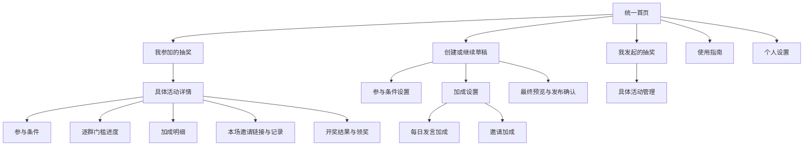

# V3.2 首页、按钮、排版与操作逻辑整体梳理 PRD

- 日期：2026-10-06（北京时间）。
- 状态：**设计整合版R2已完成，实施与验证进行中**。统一控件、完整用户路径、历史操作优化与设计修正均纳入本版，实施和验收另行记录。
- 设计修订：2026-10-06 R2，继承R1的状态/授权/编辑冲突修正，并补齐便利性与统一控件；详见[设计复核记录](v3.2-design-review-20261006.md)。设计完成不等于代码修复或生产验收。
- 范围：公开 Bot 的首页、创建草稿、活动管理、参与、门槛、两类加成、邀请记录、分享、结果、指南与个人设置。
- 基线：审查时 HEAD 为 `53d21b2`，同时读取当前未提交工作区；源码审查不代表该版本已部署。工作区存在并行修改，已修复项与仍存在的问题分开记录。
- 按钮附录：[创建与管理端清单](v3.2-navigation-button-inventory-20261006.md)、[成员与全局入口清单](v3.2-member-button-inventory-20261006.md)。
- 本版规范：[统一控件与完整体验合同](v3.2-controls-and-experience-contract-20261006.md)是本PRD的组成部分，包含控件行为、页面模板、用户路径和历史优化映射；按钮清单区分当前实现与升级目标，复核记录保留修订依据，均不构成另一套产品方案。

2026-10-07后续方案统一见 [V3.3 平台条件、双加成与完整体验 PRD（R4）](v3.3-unified-participation-and-reputation-prd-20261007.md)。按用户明确覆盖新场活跃（人品）及邀请奖励均无上限，邀请满24小时核验、同群同人一次；历史冻结规则、V3.1消息口径及本版未覆盖条款保持。§6.3/§20补公告奖品顺序与创建卡顿证据，§10继续保留完整提醒。R2积分兑换/9票/互斥建议已撤回，本轮实现及验证见[修复记录](v3.3-creator-response-and-card-repair-20261007.md)，不是整版已上线。

## 1. 核心结论与证据范围

用户指出的“发言加成、邀请加成、抽奖加成同时出现”确实存在，具体页面是**创建草稿的「抽奖预览」主面板**。普通 `/start` 首页是另一套菜单。优化必须同时解决全局首页、创建页的层级，以及成员页面的上下文和返回路径。

建议统一全局首页；创建主面板只保留一个「加成设置」入口，内部仍独立配置「每日发言加成」「邀请加成」。参与门槛与加成继续是两种不同的业务事实。创建页按填写任务分组，成员以具体活动详情为中心，所有详情返回原来的列表、分类和页码。

### 1.1 本轮证据

| 证据 | 本轮核对范围 | 可以确认 | 尚未确认 |
|---|---|---|---|
| E01 创建面板截图 | Telegram Desktop 当前可见草稿下半部分 | 三个加成入口并列、三列按钮、发布与清空位置；9 行、18 个按钮的完整计数另由源码复核 | 草稿顶部完整视觉、所有编辑页、手机端效果 |
| E02 返回首页截图 | 从草稿点击返回首页后的可见菜单 | 五个纵向按钮，与普通首页源码布局不同 | 各菜单入口完整往返、当前生产制品版本 |
| E03 当前源码 | 键盘、回调、状态处理、卡片及记录路径 | 按钮标签、目标、返回自循环、遗漏上下文、操作触发条件 | Telegram 实际送达、权限/邀请/开奖闭环 |
| E04 当前产品合同 | README 索引及 V2.2–V3.1 相关条款 | 历史导航叠加与现行业务语义 | 旧合同记载的实现或验收是否等于当前线上状态 |

截图及逐步说明见[本轮客户端证据](../../artifacts/navigation-audit-20261006/README.md)。后续客户端在锁屏状态下无法继续捕获；没有通过真实报名、修改规则、发布、取消或开奖补充证据。本 PRD 不宣称完成所有路径的真机体验验收。

### 1.2 现有可复用基础

已有逐群规则、独立门槛与加成、编辑稿、权限校验、发布确认、Outbox、个人历史结果和共享卡片渲染；本次基于这些能力整理入口与反馈。当前工作区的「取消单项加成输入保留编辑稿」、门槛搜索提示与复制目标分页已有修正，不重复列为现存缺陷；它们仍列入新交互验收。

## 2. 当前问题清单

P1 表示妨碍完成任务、误解业务状态或可能误操作；P2 表示层级、可读性与效率问题。此分级为本次产品判断，非事故严重性结论。

| 编号 | 现状与依据 | 用户影响 | 优先级 / 对应设计 |
|---|---|---|---|
| F01 | `creator_views.py:82–84` 同屏放子项每日发言/邀请，又放父项抽奖加成；E01 可见 | 难判断三个入口是否是三套奖励 | P1 / 单一加成入口 |
| F02 | `personal_flow.py:139–150,229–252` 与 `creator_views.py:23–31` 是两种首页；E02 为后一种 | 返回首页后的功能、标题和位置变化 | P1 / G01 统一首页 |
| F03 | 普通首页把参与、邀请记录、创建统计、Bot 安装、频道推荐混排 | 参与者面对管理统计，发起人面对个人奖励 | P2 / 角色任务分组 |
| F04 | `creator_views.py:68–87` 主面板9行18按钮，多行3项，字段顺序与任务顺序不一致 | 手机上难扫读，必填与可选项混淆 | P2 / C01 10控件布局 |
| F05 | 用户限制、准入条件、抽奖门槛分散；开奖方式实际只进入时间设置 | 不清楚哪些决定资格，误以为可选开奖方式 | P1 / 参与条件分组、开奖时间命名 |
| F06 | `member_bonus_views.py:91–94,293–295,345–346` 单类加成自动跳列表，返回总览又跳回原列表 | 返回按钮形成自循环 | P1 / 单类直达必须返回活动或真实父页 |
| F07 | `member_bonus_views.py:217–249` 两类总览缺活动/首页出口；创建加成直达页返回旧总览 | 页面的上级取决于入口，用户迷路 | P1 / 来源返回合同 |
| F08 | `member_flow.py:423–435` 查看加入入口链接又打开同一活动规则；私有条件正文也指向活动 | 点击后仍看规则，难找到实际入群步骤 | P1 / 真实条件检查页 |
| F09 | 登记按钮写「我已阅读，登记/查看本人进度」；不同资格状态缺不同主操作 | 用户无法预知是否创建报名记录 | P1 / 状态驱动按钮 |
| F10 | 多数分类、分页、刷新用 `message.answer` 新发面板；旧按钮仍留在历史消息 | 导航堆积，找不到当前操作面板 | P2 / 同面板导航与明确操作回执 |
| F11 | `member_records.py:198` 固定返回分类第0页；邀请明细返回另一套群列表 | 多页、多活动切换后丢原位置 | P1 / 保留来源、分类、页码、群 |
| F12 | 旧规则返回回调仍在生成，但 `member_callbacks.py:293–296` 只提示换新版 | 旧页面的返回入口不再完成导航 | P1 / 显式旧入口迁移 |
| F13 | 加成等个人路径未全部使用个人记录的私聊投递路径 | 群内旧按钮可能向公共消息位置展示本人数据 | P1 / 统一本人私聊合同；实际泄露未实测 |
| F14 | 载入上次直接覆盖；管理取消/提前截止/立即开奖/登记领奖直接执行；发布回执缺管理状态直达 | 误操作成本高，提交后无法方便追踪状态 | P1 / 影响预览、确认、状态出口 |

F10/F13/F14 为静态调用路径判断；是否在所有客户端和权限组合中复现仍需专项验收。旧聊天中仍有过去的字数提示，不能据此判断当前源码仍执行旧字数规则。

## 3. 目标、范围与合同继承

### 3.1 目标与完成标准

- 用户在任何「首页」入口看到相同菜单；能区分「我参加」与「我发起」。
- 创建主面板的短内容普通状态为10个控件，首页普通状态为5个控件；长内容分页、状态恢复等附加操作按需展示，不为凑数量删掉入口。父级和子级不重复，这不是活动数、群数或交互轮次上限。
- 每个按钮能回答：针对哪个活动/群、会执行什么、改变哪些内容、如何返回。一个具体操作用一个稳定标签。
- 所有核心路径可以返回来源，无自循环、无默认切到最新活动、无静默覆盖或把未知投递当成功。
- 公告、完整规则、本人进度分别显示同一冻结规则；必需条件写在正文，按钮只负责操作。

### 3.2 本版明确覆盖的交互条款

| 旧合同 | V3.2 明确覆盖范围 | 继续继承 |
|---|---|---|
| [V2.2 按钮合同](v2.2-button-interaction-contract.md) §2、§5 | 创建菜单树、加成总览的命名和按钮组合 | 授权、编辑稿、原子保存、确认、分页、投递事实 |
| [V2.1 多群设计](v2.1-multi-group-participation-design.md) §3.1 与 [V2.2 主PRD](v2.2-configurable-participation-bonus-prd.md) §2.1、§3.3 | 不改变多群权限政策；修正上版把主群授权现状当目标的错误 | 全局管理采用全部参与群当前管理员交集，内部兼容锚点没有额外权限 |
| [V2.3 参与者合同](v2.3-participant-button-record-interaction-contract.md) 页面导航 | 活动详情中心、个人页面返回、旧入口迁移 | 活动/用户/群身份、逐群事实、自动计奖 |
| [V2.9 体验修复](v2.9-experience-repair.md) 首页及标签 | 统一首页和「开奖时间」标签，分类入口迁入对应角色列表 | 草稿保留期、时间校验、历史结果与私聊隔离 |
| [V3.0 PRD](v3.0-participation-rules-and-feedback-prd.md) §4.1 | 原两个加成直达主面板入口改为单一「加成设置」父入口；参与条件统一分组 | 门槛二选一、两种加成独立、逐群规则、统计起点、共享有效邀请要求 |
| [公告与分享卡片](message-card-style-20261005.md) 展示用词 | 「人品加成」等模糊分类词统一为「额外抽奖次数」 | 原生图文样式、完整条件、正文参与链接、转发与Outbox合同 |
| [V3.1 计数调整](v3.1-message-counting-20261006.md) | 不覆盖 | 新消息计数口径、历史读取与不补算边界全部保留 |

本版实施和验证记录见[实现与验收记录](v3.2-implementation-and-acceptance-20261006.md)；README按该记录区分本地验证、发布和线上业务结果。

### 3.3 保持的业务语义

1. 新活动选择发言数或邀请好友门槛，并至少配置一个群；不得因整合页面新增「无门槛」「任一群达标即可」。全部参与群仍须加入。
2. 发言门槛、每日发言加成、邀请加成分别配置、分别记录；两种加成可均关闭、单开或双开，切换门槛不改变加成。
3. 明确登记且首次成员等条件通过后启动本场统计。查看规则、分享活动卡片、普通入群均不自动创建V3.0报名或发基础次数。
4. 门槛未完成时奖励保留为暂存；当前有效次数为0。完成门槛只改变资格，不重复发基础次数或奖励；最终次数以开奖快照为准。
5. 逐群独立达标，发言按北京时间自然日；本场完成的门槛不因午夜今日数清零而消失。有效邀请要求在门槛和加成间共享。
6. 新邀请加成累计不限；每日发言沿用每天一次、自定义每日轮数、每日不限。已确认邀请不因后来退群或链接失效扣回。
7. V3.1 的短文字、图片、表情、贴纸及GIF口径保留；不重新加入最低字数设置，不补算旧拒绝事件，不改历史账本/快照。
8. 所有抽奖时间用 `Asia/Shanghai`；展示、导航和复用不能改变已保存开奖时刻。已发布规则冻结，普通编辑仅操作草稿。
9. Update Inbox、Outbox、业务幂等键、Worker租约、UNKNOWN投递对账边界不变；必要状态通知、群结果和中奖私信分开记录，不受扩展提示关闭影响。
10. 指定中奖只保留隔离运维Bot/服务器控制台、白名单、资格校验及审计，不进入公开Bot页面。

## 4. 全局信息架构与术语

| 统一用词 | 含义 | 调整旧文案 |
|---|---|---|
| 首页 / 抽奖助手 | 全局导航 | 首页不再叫抽奖管理 |
| 我发起的抽奖 / 活动管理 | 创建者列表 / 某一活动的管理 | 不用「我的活动」同时指参与和管理 |
| 参与条件 | 所有资格规则的分类 | 「准入条件」仅对应其子项额外关注/加入要求 |
| 抽奖门槛 | 本场必须完成的行为 | 不叫发言加成或邀请加成 |
| 加成设置 | 创建者的两类可选奖励分类 | 移除主面板抽奖加成与两个直达子项并排 |
| 额外抽奖次数 | 面向成员的加成说明 | 统一人品加成、奖励票数等模糊表述 |
| 我的进度 / 加成明细 | 活动详情内的资格/次数区域 / 奖励来源 | M04旧路由收敛到M02区域，不增加重复中间页 |
| 分享活动卡片 / 我的邀请链接 | 宣传活动 / 个人逐群邀请归因 | 不用获取分享卡片暗示邀请计奖，两种用途在正文说明 |
| 当前有效 / 暂存 / 最终开奖次数 | 当前可用、待资格生效、冻结结果 | 不把累计账本次数统称可开奖次数 |
| 开奖时间 | 新活动定时输入 | 替换开奖方式；历史满人规则仍按原合同展示 |

## 5. 首页、指南与个人设置

G01 正文只放简短欢迎语和任务提示；创建者累计统计移入「我发起的抽奖」。五个控件固定为：

| 行 | 左侧 | 右侧 | 行为 |
|---|---|---|---|
| 1 | 我参加的抽奖 | 我发起的抽奖 | 分别打开本人参与列表、本人创建列表 |
| 2 | 创建抽奖 / 继续创建抽奖 / 查看发布状态 | 独占一行，只显示适用标签 | 无草稿时创建；未发布有效草稿恢复C01并显示期限；已形成活动身份时恢复同活动C18 |
| 3 | 使用指南 | 个人设置 | G02、G03 |

`/start`无参数、`/menu`、所有返回首页使用同一渲染及动作定义。`/new`保留恢复有效草稿的语义；不同时显示功能相同的「创建」和「继续」。草稿仍按最后更新后24小时保留，真实到期时明确提示，不因进首页静默丢弃。

恢复先核对草稿发布身份：尚未创建活动才进入C01；已有 `published_campaign_id` 或同草稿幂等来源已创建活动，即使调用/回执中断，也恢复原活动及发布阶段到C18，不提供普通草稿的再次发布/覆盖/清空。创建结果未知先按原幂等来源核查，不能以会话缺值推断未创建；活动取消后的新建必须是显式新场，旧投递身份仍保留。

G02 按「参加抽奖、发起抽奖、门槛和加成、开奖与领奖」组织短说明，含按主题查看详细说明、返回首页。Bot添加到群/频道和三个可配置频道入口放入指南及创建者准备页；未配置不显示。既有测试频道用途不变，不把外链描述为自动推荐系统。

G03 放地区资料、本人Telegram用户ID与返回首页；地区现有可修改窗口/锁定规则照实展示，不能因为换页而重新开始。命令菜单统一对应页面：`/start`首页，`/new`草稿，`/index`我发起的抽奖，`/join`我参加的抽奖，`/help`指南，`/region`地区，`/myid`本人ID；旧 `/menu`作为首页别名。群 `/getid` 保持群ID用途。

## 6. 创建草稿与配置

### 6.1 C01 主面板：编辑草稿

尚未形成活动身份的草稿标题为「创建抽奖 · 编辑草稿」。正文顺序为：草稿标题与未发布状态 → 待补齐项 → 已保存基础信息 → 逐群参与条件与门槛 → 两种加成摘要 → 时间与通知设置。封面、说明、默认用户名/地区和消息参数属于可选项，不显示为阻碍发布的必填；发布过程中的恢复进入C18。

| 行 | 左侧 | 右侧 |
|---|---|---|
| 1 | 活动标题 | 奖品与领奖 |
| 2 | 参与群 | 开奖时间 |
| 3 | 参与条件 | 加成设置 |
| 4 | 封面与说明 | 更多设置 |
| 5 | 预览并发布（独占一行） | — |
| 6 | 返回首页（草稿保留，独占一行） | — |

共10个普通控件。顶部显示「下一项：具体必填项」，主按钮按参与群→标题→奖品→抽奖门槛→开奖时间顺序跳过已完成项，直接打开具体编辑页，例如「设置抽奖门槛」；都完成后为「预览并发布」。无可管理群先进入准备/检测页。其余入口始终可自由编辑，这是提示顺序而非强制向导；主面板不直接发布、清空或覆盖。

正文至少给出每个群的门槛和两类奖励摘要；超过普通文本容量时按完整群块明确分页，不截掉条件。C01的摘要使用已保存草稿值，编辑中的值标为「未保存修改」，不能混作已生效。

### 6.2 基础内容、参与群与时间

| 页面 | 按钮与输入 | 保存与返回 |
|---|---|---|
| C02 标题 | 当前标题、输入格式/长度；取消输入 | 有效文本按既有字段保存返回C01；错误保留当前页和旧值 |
| C03 奖品与领奖 | 奖品/领奖说明摘要；添加、删除指定项、清空、领奖说明、返回草稿 | 组合入口先打开总页，点子操作才输入；两步新增，删除/清空确认，不新增单项编辑 |
| C04 参与群 | 选中状态、刷新、分页、完成选择；群多时搜索/清除 | 沿用即时保存；同名同类型无用户名时，以对应正文的序号及必要ID尾号区分，始终绑定真实群身份 |
| C05 开奖时间 | 已保存时间；7天后、10天后、明晚20:00；直接输入北京时间；返回草稿 | 保留复制正文日期的能力，不增复制按钮；格式/无效日期/不足5分钟分别报错；发布时重核验 |
| C14 封面与说明 | 封面状态/说明摘要；上传或替换、说明、清除（有图）、返回草稿 | 组合入口先总页，点子操作才收文本/图片；上传回执为当前面板，可连续替换，完成回C14；清除仅封面 |

参与群删除前列出本群门槛、发言加成、邀请加成受影响的未发布配置；新增群默认无行为门槛且加成关闭，仍必须加入。额外关注项与参与群保持互斥。权限错误列出具体群、创建者/机器人缺什么，不自动跳过不可用群。

移除确认同时列该群已保存规则、未提交门槛/加成编辑值及复制来源/目标；确认后在同一草稿变更中清理该群全部引用，保留其他群编辑值，取消不改变任何引用。正在编辑的群被移除则回原模块群列表并说明，旧群编辑稿不能重新保存已删除目标；新增/删除即时保存后，剩余编辑稿的来源基线同步到新草稿revision。

奖品名称输入页提供「取消新增奖品」；人数页标明尚未加入清单，提供重新输入名称/取消新增。非法人数保留名称；有效人数提交才原子追加并清pending，重放不重复新增；取消只清本笔pending并回C03，跨模块离开保留pending，返回继续原步骤。人数单位固定为「人」，不与奖励次数混用。

### 6.3 C06 参与条件设置

正文分「必须加入全部参与群」「额外关注/加入要求」「用户限制」「抽奖门槛」。键盘提供额外关注/加入要求、用户限制、抽奖门槛三个子入口，另有「修改参与群」次操作和返回草稿。修改参与群使用绑定本人、草稿和revision的授权按钮，C06→C04→C06；不把不可执行的正文文字当入口。

C07 额外条件沿用管理员群/频道选择、链接或来源可见转发、搜索/清除、分页/刷新和移除；每次勾选/添加立即保存并反馈，完成选择只返回条件页。这里不伪装为批量编辑稿，也不提供会撤销已保存选择的笼统取消。C08 用户限制包括用户名和地区条件，当前值可读，改动保留原条件页上下文。

C09 门槛页显示唯一模式的选中状态，再显示逐群阈值。发言群编辑每日条数和连续天数；邀请群编辑有效人数；不展示最低字数。未选群时提供选择参与群入口；配置群为零不能保存完整门槛。切换模式先编辑，保存时明确替换旧模式；取消不改变已保存模式或两类加成。

门槛采用「本群暂存到编辑稿」→「保存本场门槛」两层明确标签；本群暂存后提示整场仍未保存。搜索、复制目标、分页保留当前编辑值。取消数字输入只结束该字段；放弃整场修改要明确表达，不复用含义不清的「取消」。

### 6.4 C10 加成设置：唯一总入口

正文首句：「以下只增加抽奖次数，不能替代参与条件或本场门槛。」显示每日发言和邀请分别开启的群数、具体摘要及未配置状态。按钮为「每日发言加成」「邀请加成」「返回草稿」；此页不放第三个总开关，也不在C01重复放两个子入口。

C11/C12 两类列表分别提供本模块开启/关闭、逐群编辑、复制到选定群、分页、返回加成设置；邀请页另有共享「有效邀请要求」。关闭一类只停止该类草稿配置生效，保留可恢复的已配置参数，并清楚显示关闭；不改变另一类或门槛。

- 每日发言：每轮条数、奖励次数、每天一次/自定义每日轮数/每日不限；提示北京时间自然日。只有本群保存才写回该群草稿规则。
- 邀请：每几个已确认有效新成员增加1次，新场累计不限；不显示邀请上限编辑按钮。历史有限规则只按历史读取，不迁成新场默认。
- 复制：正文列来源、目标和覆盖字段，确认只覆盖同类模块；未选目标不修改任何群。
- 已开启模块用「保存本群设置」；模块关闭时用「保存并开启本加成」，正文列出本次及其他将恢复的已配置群/规则；放弃本群修改不启用模块。取消单项输入保留其他编辑值，保存/放弃回本类原群列表，列表回C10，C10回C01。

加成复制只从已保存完整规则发起，未提交值先按原合同保存或继续编辑，不能复制隐含的working copy；门槛复制则属于门槛外层编辑稿，暂存不等于整场保存。两种复制的范围在页首分别写明。

C13 有效邀请要求是门槛/加成共享配置，从哪个页面进入就回哪个页面；同时显示报名截止、最晚计奖入群时间、计划开奖。邀请门槛单开也能配置，不依赖邀请加成开关。

共享指最终生效口径相同，不代表绕过编辑事务。门槛来源的留存随外层门槛稿提交或放弃；邀请加成来源沿用即时保存，说明同时影响门槛和奖励。编辑稿记录共享字段的基线及本人是否改过：其他入口更新后，未修改的旧快照同步到新值；两边均有显式不同修改时列出基线/当前/待保存值，选择保留哪项并复核时间，不按最后打开或保存整稿自动覆盖。解决留存冲突不丢其他门槛参数，也不悄悄提交外层编辑稿。

时间展示与校验沿用[V3.0 §7.1](v3.0-participation-rules-and-feedback-prd.md#71-三个时间与门槛可完成性)：新定时场截止＝计划开奖−5分钟，邀请最晚有效入群＝实际截止−留存；提前截止还需取既有归因路由窗口更早边界。强制门槛须有可完成的自然日/留存窗口，时间修改、共享留存写回、门槛保存、确认及必要消息全部实际确认时均复核。仅可选邀请加成无窗口只明确提示，允许创建者保留，不阻止可完成的发言门槛，不缩短留存或自动改期。

### 6.5 C15 更多设置与草稿操作

上部为「发奖人员」「消息提示」；底部单独分为「载入上次抽奖配置」「清空并新建草稿」「返回草稿」。消息提示的开关/延迟调整保留在消息页并刷新当前值，完成后返回，不每改一项跳回主面板。

载入上次先列来源活动及将覆盖的字段，未保存内容有改动时明确确认覆盖；取消保留全部原内容。复用只复制可复用业务字段，并清掉旧活动身份、具体时间、远端消息、个人/群邀请入口、运行/资格事实；旧满人或旧门槛配置若不符合新场合同，标出需要重设的项，不默认为可发布。

清空页说明将删除当前未发布草稿配置及可否恢复，按钮为「确认清空并新建」「保留当前草稿」。普通返回、返回首页、关闭加成都不得复用清空动作。

### 6.6 C16 最终公告预览与发布

显示实际公告样式，使用共享卡片渲染；创建者编辑摘要与最终卡片是两个明确阶段。条件长文完整显示/明确分页，规则页与主卡共用冻结清单。

确认页按钮为「确认发布」「返回修改」；确认前列出参与群、必需条件、门槛、两类奖励、截止/开奖时间、奖品与通知设置。提交后显示「发布请求已提交」，附「查看投递状态」「返回我发起的抽奖」。沿用V2.8同活动正文入口；发布中明确尚未开放，只看规则/状态，不提前报名。「分享活动卡片」按现有开放状态合同提供，不把隐藏入口当发布成功条件。

规则页和全部主卡确认是必要条件，同时须按实际确认时点复核强制门槛可完成性；来不及时保留发布问题，不转进行中、不顺延截止。失败列具体目标与原因；未知结果显示待核查。只重试原机制认定可重试的明确失败项，不给UNKNOWN直接重发按钮；刷新仅查询，不暗中重发。

## 7. 成员：活动详情、进度、邀请与结果

### 7.1 M01 本人参与列表与 M02 活动详情

列表保留进行中、待开奖、已结束分类，逐条用自然序号、完整活动名、开奖时间识别；内部ref不作为主要文案。同名活动用时间区分。分页/详情返回保留类别、页码和排序；空态说明仅查本人已登记活动，可看指南或现有已配置导航频道，不新增全站活动发现功能。

跨活动的「我的邀请记录」移入此列表页，保留本人活动聚合→群→筛选/分页能力；旧 `nav:invites` 直接进入该聚合页。成员不必逐个打开活动才能回查邀请，聚合页保留活动分类、页码与返回本人参与列表/首页。此次只移动首页入口，不删除邀请记录能力。

详情正文顺序：活动名和状态 → 我的登记/资格状态 → 当前有效/暂存次数 → 未完成条件及下一步 → 截止/开奖时间 → 奖品和完整规则入口。已结束先展示结果与领奖，再展示历史累计记录；不能以当前账本代替最终快照。

M02直接内嵌「我的进度」区域，M04只作该区域和旧路由别名，不再单开同内容中间页。已登记用户直接进入门槛进度M09、加成M05、个人邀请M06或记录M07；主操作指向当前实际任务，不在已显示进度的页面再给“查看我的进度”自跳按钮。

首次 `join_` 在独立登记前前置显示全部必需条件，不只显示未完成项：所有参与群、额外关注项、用户名/地区要求、逐群门槛、统计起点和截止/开奖时间。长内容按同一冻结manifest分页，每页带活动身份、规则版本、当前/总页数和原路返回；未满足/已满足/未检查的规则均可读。登记入口位置固定，浏览/设置/翻页不登记；不新增“必须点完所有页才可登记”的条件。发布所需规则页送达完整性与成员是否点击阅读是两种事实。

| 本人及活动状态 | 主要操作 | 次要操作与说明 |
|---|---|---|
| 未登记，登记服务允许且未截止 | 登记参与 | 完整条件前置；无可完成窗口时先明示，再由本人决定是否登记，不新增拒绝登记规则 |
| 已登记，成员条件缺失/待批准 | 查看并补齐参与条件 | 重新核验、我的进度；列具体群/频道及未知原因，不能写已合格 |
| 成员通过，门槛未完成 | 发言模式查看门槛进度；邀请模式用我的邀请链接，窗口另判 | 单群可直达；只等待旧事实时看待核验记录；不承诺仍能完成 |
| 当前条件合格，开放 | 有可选奖励时查看加成明细，否则查看抽奖次数 | 我的邀请链接/记录、完整规则、分享活动卡片 |
| 发布中 PUBLISHING | 查看规则/投递状态 | 无已开放承诺；不登记，已保存个人事实仍可读 |
| 已发布待运行 SCHEDULED | 按登记、邀请入口、分享各自原允许状态展示 | 与发布中分开；发言计数/邀请核验另判，不承诺已开始计奖 |
| 人工暂停 PAUSED | 查看暂停影响及既有进度；邀请相关按原模块能力展示 | 不一刀切隐藏邀请归因/入口；发言与奖励核验按原暂停语义，不顺延截止 |
| 运行权限阻断 | 查看具体故障群/条件及恢复途径 | 与人工暂停分开；新报名/开奖按原阻断合同，正常群和故障群的事实处理分开 |
| 已截止/结算/复核/开奖处理中 | 查看历史进度/当前处理状态 | 不显示报名或做任务引导；邀请留存等既有待核验事实按冻结规则处理 |
| 已开奖 | 查看开奖结果 / 中奖者联系发奖人员 | 最终次数、本人历史记录、完整规则；不引导新增计奖 |
| 已取消/归档 | 查看取消原因或已保存结果 | 归档不能替代开奖事实；缺结果明确核查，不伪造未中奖 |

按钮判定顺序为：同活动终态/取消事实及实际截止 → 运行阻断与各模块允许状态 → 模块时间窗口 → 本人登记/当前资格/门槛。登记、发言计数、邀请归因、邀请核验/入账、取个人入口、分享分别取原服务能力，不能由统一“开放”布尔值决定。SCHEDULED的登记/分享及PAUSED/SCHEDULED允许的邀请事件保留，但邀请核验可能延后；恢复不能补造暂停或不可观察时段的消息。

所有详情有原路返回和首页；深链无来源时已登记者回M01，未登记者回首页。任何活动状态下，本人已有参与记录即可只读已有门槛事实、加成账本和邀请记录，不依赖当前ELIGIBLE；新入口获取、计奖、当前/最终资格另行核验。失权/未知不删除历史奖励或展示“奖励清零”；未知有效次数标待核查且不据此确认合格或纳入最终名单，已证实不合格时当前有效0并说明原因。重新通过不重置起点/重发基础次数，不回填离群期消息；未知来源事件仍待核验。

### 7.2 M03 参与条件检查

「查看加入入口」必须打开逐项实际检查页，不能再次打开同一规则页。正文显示每个群/频道的加入/关注要求、当前核验状态、具体入群操作；公开目标可直链，私有入口只经活动身份和现有权限路径取出给本人，不把私有URL写进公开公告。

未登记可以只查看条件及加入操作；这里不自动创建报名。重新核验按钮只在已登记状态出现；未登记时用独立「登记参与」。本人邀请归因链接与普通补齐条件链接分开，后者不自动获得邀请归因。链接撤销/准备中/权限错误分别显示，提供返回活动和已存在的重核验路径，不绕过条件。

M03同时列全部用户限制。未设置/可修改的地区问题提供G03入口，设置后回原活动；地区已锁定且不符时显示允许值、本人值及锁定截止，说明当前无法满足，不诱导重复修改或重置锁定。用户名缺失提供Telegram客户端设置说明，回来后按登记状态重新核验或登记；本人ID不是可由Bot代改的用户名。条件浏览及资料设置不自动登记。

### 7.3 内嵌进度、M09门槛与M05加成明细

我的进度正文分「成员条件」「本场门槛」「次数明细」，逐群显示目标、已完成值、差值/完成日期；同时显示今日发言与本场已经完成的门槛事实，跨日归零只影响今日统计。

活动详情直接提供查看门槛进度、加成明细、我的邀请链接、邀请记录。M09是逐群门槛列表/详情；只有一个适用群直达详情。M05只有一类时省类型选择、只有一个群再省群选择，多类/多群才显示对应选择页。被省掉的页面不作为返回目标；返回按实际origin生成“返回活动详情/加成明细/邀请记录”等具体标签，不自循环。

加成群详情写明规则、今日/累计已获次数、暂存/当前有效状态，不用获取/领取按钮暗示手动发奖。全部关闭时显示无额外奖励，门槛进度仍可查询。

发言门槛/加成的群详情提供「去本群发言」，仅使用已存在且可用的普通群入口，正文保留完整群名；无可用入口明确原因、不伪造链接。回Bot仍定位同活动同群进度，不把打开群当完成任务。邀请门槛详情链接到同群M06/记录，门槛和奖励阈值仍分开显示。

### 7.4 M06 本场邀请入口与 M07 邀请记录

邀请入口按本活动、本用户、本群产生；列表是「邀请门槛目标群 ∪ 邀请加成目标群」，同一群只有一个入口，正文明确用途为完成门槛、增加次数或两者。仅开启邀请门槛也能获取；获取前实时校验已有成员条件及现有邀请权限。

各群正文显示已确认人数、待留存/待核验人数、门槛K、奖励比例、已获得次数、最晚计奖入群时间和可复制的本期链接。新场累计不限不等于绕过留存或截止。停止新增引导后，隐藏获取入口与「再邀请多少人」提示；仍有效的旧链接是否能入群照实说明，保留已确认奖励。

本人取链接请求确认后，原私聊投递直接带「复制我的邀请链接」「转发邀请」「查看本群记录」，不用返回总览再选群/获取。仍在同群当前页可更新，已导航离开不抢回页面；刷新仅查询，未知不补发。链接可用与私聊消息送达分别说明，未确认时不提供承诺可用的复制/转发。

尚未截止也须区分：仍可新增完成、仅等待既有截止前事实留存/核验、已无可完成窗口。最晚入群恰等时点仍按原合同接受（超过才停止新增计奖引导）；自然日不足或没有可核验既有邀请时说明具体缺口，不降低门槛/自动改期。只剩旧邀请待核验者可看记录/刷新，发言门槛已完成者仍可按原截止复核；一个奖励无窗口不关闭另一种可用奖励。创建请求、链接已确认、未知和失效分别反馈。

记录保留活动→群→状态筛选→分页；返回携带来源页、活动分类、记录分类、页码与群页。已入群、待审核、待留存、有效、无效分别呈现，不把打开链接或提交入群申请写成邀请成功。已有确认值与奖励数字不一致时解释来源或明确核查，不能为看起来一致重算历史。

### 7.5 M08 次数、结果与分享

次数页区分基础、每日发言、邀请、累计、当前有效、暂存。同活动已完成DrawRun才展示快照最终次数、实际开奖时间和本人结果；本人未在快照中显示未进入最终名单/无最终次数，不用当前账本或补0代替。有取消审计且无完成开奖时显示已取消/未开奖，仅列取消时可确认账本，不虚填最终0次、实际开奖时间或快照。归档以完成DrawRun优先、取消审计其次解释；事实都缺则结果未确认、明确核查。联系发奖人员只打开已有身份，不推断实际交付。

「分享活动卡片」仍发送本人可转发的同活动公告，不报名、不发次数、不生成个人归因；旁边说明“计入本场邀请进度请用你的个人邀请链接，活动卡片只用于宣传”。「我的邀请链接/复制我的邀请链接/转发邀请」专用于个人逐群归因。终态旧分享入口显示真实状态/规则/结果，不续发开放任务卡；请求/发送确认/失败/未知分别反馈。

中奖结果页完整展示已有领奖说明，提供联系发奖人员和复制领奖联系信息；复制使用同活动链接、本人TelegramID及对应奖品顺位/名额的短模板，名称正文完整，按原生复制容量校验。多奖品逐项可辨识；复制仅进本人剪贴板，不自动发消息、不标记已申请/已领奖或实际交付。

## 8. 创建者列表、管理及操作确认

C17「我发起的抽奖」承接创建统计与分类，包含发布中、进行中、待开奖、已结束；只有有数据/适用时显示失败待核查。参与者状态与创建者投递状态不用同一个标签混写。列表分页、详情返回保留上下文；没有创建活动时显示创建入口及Bot准备指南。

C17始终有「创建新抽奖」，旧场发布中/待核查无需先取消。显式另建使用新草稿/活动身份，旧场恢复阶段须持久绑定原活动，不能仅靠被新草稿覆盖的单会话；已有未发布稿则选择继续或明确确认替换，默认 `/new`仍按原恢复合同。创建/可管理列表必须能翻到全部有权记录，不能将前20条切页当全量；排序变化按稳定活动身份定位，删记录/失权越界明确回有效页。

当前「我可管理」按兼容主群管理员查询及授权，是实现现状，不是多群合同目标。C17保留该入口并校正范围：全局管理/敏感详情按[V2.1 §3.1](v2.1-multi-group-participation-design.md#31-选择参与群)、[V2.2 §3.3](v2.2-configurable-participation-bonus-prd.md#33-权限矩阵)实时核对全部参与群管理员交集，单群等价核验唯一群；兼容锚点无额外权限，缓存仅作候选。本人创建记录和已公开规则/结果可读，不默认授予管理权；任一目标失权/未知时指出具体目标。全群新管理员可进入管理，但不取得隔离指定中奖权限。

C18 活动管理正文为活动身份/规则 → 生命周期状态 → 发布投递明细 → 当前可用操作 → 统计/结果。逐目标显示规则页与主卡状态；参与人数、有效候选人数、开奖快照人数有独立标签。现有查看参与者/登记领奖沿用权限和审计，不增加公开排名。

| 操作 | 按钮/确认要求 | 完成反馈 |
|---|---|---|
| 刷新状态、查看规则/统计/参与者 | 只读，无确认；保留来源 | 更新面板，不发新活动/不发次数 |
| 暂停/恢复 | 显示当前影响及明确动作；执行时复查状态/权限 | 状态变更回执与最新管理页 |
| 提前截止、立即开奖、取消活动 | 移到独立活动操作区，先展示活动、当前状态、后果；确认动作独占行 | 按真实服务结果提示，结算不等于开奖完成 |
| 登记已领奖 | 显示中奖人、奖品、名额和标记含义，再确认 | 审计确认后才显示已登记，不等于实际奖品已交付 |
| 重试明确失败的发布项 | 列可重试目标/原因，按现有资格确认 | 返回逐目标状态；UNKNOWN继续待核查 |

确认取消返回原管理页面；重复确认由原幂等/状态约束处理，不能产生第二次开奖或领奖记录。指定中奖仍不在本页出现。

运行阻断是独立事实覆盖层：显示故障群、缺失权限/未知、修复说明及重新检测；按原合同阻断新报名/开奖，正常群已有登记的事实按模块继续处理，故障群不补造。权限恢复不等于解除人工暂停，也不顺延时间；状态确认页到执行期间权限/生命周期已变化时明确不执行原动作并更新页面。

发布中取消只确认活动生命周期；投递是否尚未发出、已确认或UNKNOWN分别保留。原机制可以明确停止的未调用远端项才标停止，在途/UNKNOWN保留Attempt与消息身份并继续对账；迟到确认不能重新开放活动，后来确认的规则页/卡片同步同活动取消状态。取消后的C18仍显示未决投递与只读刷新，不盲重发、不为清队列删除历史证据。

动作仍受原生命周期限制：RUNNING可暂停/提前截止/取消；PAUSED可恢复/提前截止/取消；SCHEDULED可提前截止/取消；READY_TO_DRAW才可立即开奖；DRAFT/PUBLISHING可取消；DRAWN可登记适用领奖；复核受阻时保留已有重新复核资格入口。处理中及终态也必须有只读刷新和返回出口，不能因无写操作就变成无按钮页面。

## 9. 所有页面共用的排版与导航合同

### 9.1 正文与键盘

- 正文使用固定顺序：页面名与活动/群 → 当前状态 → 关键数据或条件 → 下一步说明 → 操作键盘；分段用短标题和空行，避免每个字段都配装饰图标。
- 普通操作每行最多2项；主操作独占行，返回在最后。数值减/当前值/加属于同一字段控件，可保留3项；筛选和预设按含义排列，不套用普通操作行限制。
- 不用仅有emoji的按钮或状态。选中用文字/勾选双重表达；长群名与活动名放正文完整显示，按钮可用自然序号，不能成为唯一身份信息。
- 资格、门槛、加成、投递分别有明确状态。已开启但未配置群显示「待逐群设置」，不能写为已生效。
- 主卡、图片caption、长规则继续采用原容量测量和完整块拆分；可见容量不够就分页，不能靠删条件/缩字解决。页面数字示例不是新的业务上限。

### 9.2 导航、输入与保存

导航上下文至少保留 `origin_page、campaign_ref、group_ref、category、page、filter、draft_revision`；在现有服务端会话/授权grant中保存，不把全部上下文拼成超长回调，也不加新的业务账本。

纯查看、分类、分页、刷新更新同一个有效操作面板；用户命令可以创建新的当前面板。正式公告、分享卡、状态通知、操作完成回执按各自现有投递语义产生新消息。不得把这条规则解释成删除历史公告/审计消息。

仅在媒体替换、面板已不存在/无法编辑等有明确证据时建立新面板，告诉用户旧面板已停用并保留错误/新身份；不能捕获所有异常后悄悄新发消息假装成功。旧授权按钮不能改当前草稿；旧只读按钮可明确转到同活动当前页，涉及写入只给「继续当前草稿」等恢复入口，不执行旧动作。

| 用户动作 | 含义 |
|---|---|
| 取消输入 | 取消单个字段输入，回该编辑页；其余编辑值保留；标题等即时保存字段尚未有效输入时保留原值 |
| 返回上级 | 无未保存改动时回实际父页；有编辑稿改动时说明保存/放弃影响 |
| 保存本群 / 保存本场门槛 | 分别写回对应草稿层级，完成后展示保存范围 |
| 放弃本群/本场修改 | 仅恢复对应已保存值，不清空整个草稿 |
| 返回首页（草稿保留） | 只导航并保留已保存配置；不暗示全场提交；有编辑稿时处理明确的保存/放弃范围 |
| 清空并新建 / 载入上次覆盖 | 先显示实际影响，用户确认后才覆盖 |

参与群、额外关注项、单值字段和消息开关沿用明确的即时保存；门槛、加成群编辑和规则复制使用对应编辑稿。每页首部写明本页保存方式，「返回上级」的未保存确认仅适用于存在编辑稿的页面，不能让即时保存页凭空出现可撤销的承诺。

按钮、`/start`/`/help`等命令及活动深链跨模块离开使用同一导航语义：先停止当前字段文本接收，保留目的页、原位置、已保存值和待编辑值；有未提交稿时提供保存对应稿后前往、放弃对应稿后前往、继续编辑，保存失败仍留原页。仅输入中的未提交文本不自动保存，返回编辑时可继续该字段；来到成员页的新文本不送给旧草稿。真实24小时到期后只提示过期并给显式新建入口，不把迟到文本写进新草稿、不承诺恢复过期值。

所有编辑/确认都绑定草稿/活动身份及revision。另一路保存后，未改共享字段跟随当前基线，两边显式改同字段则列冲突；旧确认不覆盖新值。读页保持同冻结版本，分页时状态或目标变化先明确刷新原因并保留可定位来源，不拿旧页码去执行新的写动作。

群操作绑定稳定Group/participation_group身份，Telegram调用解析当前chat ID；改名/升级及新旧路由别名不重建本场进度、归因或奖励。名称/序号/尾号只是显示，不作为业务键；活动/记录服务端按完整范围逐页查询，不先取前20条或全量进内存后伪分页。

### 9.3 统一控件与反馈规格

所有页面遵守[同版控件体验规范](v3.2-controls-and-experience-contract-20261006.md)UC01–UC18，统一标签、当前值、单位、选中态、作用范围、保存方式和具体返回；不把普通可逆查看操作增加确认步骤，不用符号或颜色独自表达含义。

按钮点击先回应callback结束客户端等待，随后展示真实处理/结果，回应不等于业务成功；长任务有可查询状态及离开入口，不给未经证实的完成时间。成员控件统一用「抽奖次数」，内部票账本名不成为第二套可见单位。

| 控件族 | 本版统一行为 |
|---|---|
| 导航/主操作/返回 | 具体动词与对象；一页一个明确主操作；返回实际origin，组合入口先摘要后子操作 |
| 开关/单选/多选 | 当前状态正文可见；即时保存或编辑稿写明；本群/本模块范围明确，跨页勾选保留 |
| 数值/预设/输入 | 人、条、天、轮/日、抽奖次数分别标单位；一次只改该字段，非法输入保留旧值/pending |
| 搜索/分页 | 显示关键词/筛选/页码；清除搜索不清选择；零条/越界明确处理；页码写正文，不伪装刷新按钮 |
| 保存/取消/破坏操作 | 明确本字段/本群/本场范围；关闭模块后的保存真实标出启用影响；覆盖/清空先列实际后果 |
| 复制/转发/链接 | 复制仅剪贴板；转发由本人选择目标；宣传/归因不同文案；链接未确认不写可用 |
| 刷新/处理/失败/未知 | 刷新只查询；请求完成直接交付适用操作，不强制反复刷新；已离开不抢当前页；错误给对象、原因、可执行恢复 |
| 图片/长正文 | 上传回执是当前封面面板，可连续替换；离开后不误收；完整块分页，关键条件不靠按钮截断 |

### 9.4 完整用户操作路径

规范附录UP01–UP08逐步定义首次参与、发言任务、邀请、领奖、首次创建、编辑复制、多活动复用、发布管理；每条明确起点、操作后反馈、来源返回和失败恢复。最重要的路径为创建缺项直达、详情直接到逐群任务、取链接确认直接复制/转发、领奖说明直接联系，不让用户跨页面重复寻找同一信息。

旧优化映射也属于本版验收：统一首页/旧深链、24小时草稿/旧面板、封面连续替换、北京时间/自定义与保存时刻、额外条件勾选/搜索/刷新、门槛与两种逐群加成/单项取消/复制、历史复用、条件完整前置/原生分享、逐群达标提醒/午夜保留、真实结果/群公告与中奖私信、隔离运维边界。不能为新布局撤回这些体验。

## 10. 技术落点、兼容与通知

统一首页和导航动作定义；创建页面按页面职责拆分渲染；成员活动详情统一由当前活动/本人状态生成可用按钮。所有返回目标有可检查的定义，同一按钮族不在多个文件复制不同逻辑。继续使用 `campaign_card.py` / `participation_rules.py` 的规则投影。

保留既有公开 `join_`、`share_` 和邀请入口的活动身份；旧callback有显式迁移响应，不能只说失效却无可用入口。旧满人、旧有限邀请和旧累计发言模式只保留必要读取/结果展示，新创建不重新提供已移除配置。迁移不改历史数据、不放宽资格、不强制结束活动。

本版不要求数据库迁移；实施时若现有会话/grant不足以表达上下文，先补充最小技术设计再实现，不另建参与账本。发布、取消、开奖、领取、分享等继续由现有服务授权和审计；渲染页不直接创建业务成功事实。

控件和页面共用一份目标规范与状态投影，避免各模块复制不同标签/单位/返回算法。实施技术设计须说明活动级发布恢复的持久映射、全量分页读取、原生复制容量及当前SDK支持，不靠模拟成功、假禁用或截断数据满足控件样式。

| 通知/反馈 | 展示与完成边界 |
|---|---|
| 字段保存、输入错误、面板过期 | 当前编辑范围与恢复入口，不宣称业务发布成功 |
| 门槛达标、发言/邀请奖励 | 同活动/用户/群，说明暂存或生效；自动入账，无手动领取 |
| 发布、分享投递 | 入队/已确认/明确失败/未知分别显示 |
| 截止与未达标 | 显示原门槛和本人结果，不再引导新增任务 |
| 群内参与/加成/邀请前置失败 | 开放中的群卡保留参与链接，并提供「邀请入口」「我的加成」回调。用户在群内点击入口但尚未登记、未满足对应加成或该群未开启对应规则时，在原群发送临时说明及本活动参与链接；消息经 Telegram 明确确认后延迟 15 秒删除，不能替代必要达标、结果或中奖通知，私聊仍按弹窗反馈 |
| 未报名成员发言 | 在活动统计窗口内且当前仍开放报名，本群配置了发言门槛或发言加成时，未报名成员的有效类型发言触发原群提醒，提及本人、标明活动、提供同一参与链接，说明本条未计入本人抽奖进度。提醒不自动报名、不补计报名之前的发言；同活动/用户/群五分钟内最多一次，更新重放不重复。机器人、服务消息、转发、命令、空内容不触发；已有报名但资格失败不误报为未报名。旧邀请规则所需的受邀人发言核验照常执行 |
| 未完成的发言/邀请进度 | 有效发言或有效邀请尚未达到本群门槛或下一档加成时，在对应群发送当前进度；确认送达后 15 秒删除。已达上限不再提示还差。达标、截止、结果和中奖通知保持持久 |
| 群结果与中奖私信 | 两条独立证据；扩展提示关闭仍保留；客户端声音/弹窗单独核验 |

完整继承[V3.0 §6通知矩阵](v3.0-participation-rules-and-feedback-prd.md#6-达标提醒个人进度与失败反馈)：本群门槛完成立即提示，不等全群；同来源、本活动/用户/群的本群完成、全场完成及奖励合并一条，取事务最终次数及暂存/生效状态。不同群/日/来源不乱合并，重放不重复；延迟送达标事件日期和完成时事实，午夜仅重置今日数。连续断日、旧累计达标、截止未达标分别说明。

群按钮查询的个人详情、跨群账本、邀请记录和个人链接只投递本人私聊；既有本群必要达标/奖励通知按合同在对应群显示本群事件及用户提及，属于通知而非公开查询，不扩散完整跨群明细。用户可见文案使用“处理中/发送已确认/发送失败/结果待核查”等具体含义，内部Outbox/Attempt状态不直接堆进成员流程。

2026-10-07 相邻入口修复合同：群卡加成、`bonus_` 私聊深链及旧 `m:bo:` 导航，均以同活动本人已有参与记录作为只读入口条件，不要求当前资格合格；资格不合格或未知时保留历史奖励说明，新增个人邀请入口仍须原资格校验。旧版仅发言加成按原规则读取当天发言及既有账本，不依赖邀请链接、不把旧规则转换成新逐群计奖规则。群内旧加成导航的未登记、未开启或已移除规则错误统一形成原群临时提醒，确认后 15 秒删除，私聊保持原反馈。参与条件失败的详情私聊发送不可达时记录异常并明确提示打开或解除屏蔽机器人；其他 Telegram 发送失败保留待核查语义，不向群公开私人详情，不宣称私聊已送达。

平台限制核对日期为2026-10-06：[Telegram InlineKeyboardButton](https://core.telegram.org/bots/api#inlinekeyboardbutton)的回调数据范围为1–64字节；[消息编辑](https://core.telegram.org/bots/api#editmessagetext)支持更新文字及内联键盘；[深链参数](https://core.telegram.org/bots/features#deep-linking)最多64字符。实施沿用当前普通消息/内联键盘能力；是否采用新版disabled等新字段须先核对实际SDK和客户端，不能仅依据旧知识宣称平台无此能力。上述平台能力不代表本项目已完成改造。

## 11. 验收矩阵

以下均为未来实施的通过标准，**不是本次已通过结果**。先做路由/渲染定向验证，数据库测试必须走上海Docker执行器，每进程硬超时60秒；文档评审不运行后端测试。

| 编号 | 场景 | 可验证通过标准 |
|---|---|---|
| AC01 | 所有无参数首页入口 | 同菜单同位置；创建按钮随真实草稿状态变化；活动深链仍进原活动 |
| AC02 | 草稿主面板 | 正常10控件；加成仅一个父入口；必填/可选、已保存/编辑稿可区分 |
| AC03 | 全按钮返回审计 | 附录每个按钮族有目标与出口；来源页/类别/页码/群保留，单类加成无自循环 |
| AC04 | 两种门槛×四种加成 | 八组合的配置、逐群展示、资格、次数语义一致；关闭一项不串改 |
| AC05 | 邀请门槛单开，无加成 | 本人通过成员条件后可获取对应群入口，用途不承诺奖励 |
| AC06 | 不同群阈值、跨日完成 | 逐群计数与完成日期；本场达标不因今日0条消失，未合格时有效0 |
| AC07 | 成员缺条件、待批准、未知 | 真实检查页与加入入口可达；查看不登记；未知不等于合格 |
| AC08 | 保存/单项取消/放弃/模式切换 | 保存层级明确；单项取消保留其他编辑；放弃恢复旧值，不丢整场配置 |
| AC09 | 群添加/删除、额外条件删除 | 显示关联影响；只改目标群/模块；不存在静默无门槛场 |
| AC10 | 搜索、复制、分页、同名目标、跨活动邀请聚合 | 清除搜索可用，来源不在目标集；复制确认不改其他模块；旧邀请聚合入口可达；返回保留页码 |
| AC11 | 标题/人数/条数/时间非法输入 | 原值保留、错误具体、当前页可继续；V3.1无最低字数控件 |
| AC12 | 自定义/快捷时间、复用 | 北京时间一致；复制旧配置不保留旧具体时刻/身份；发布实时复核 |
| AC13 | 双击、旧按钮、草稿过期 | 无重复写入；旧面板有恢复入口；明确24小时到期语义 |
| AC14 | 纯导航与消息生命周期 | 刷新/分页不堆新面板；公告/回执不被删；明确编辑失败不被吞掉 |
| AC15 | 群卡/落地页/完整规则/分享 | 冻结条件一致、文本完整、私有入口不公开；同链接且分享不报名 |
| AC16 | 发布等待/失败/未知/确认 | 状态与目标证据一致；刷新只读；未知没有盲重发；管理出口可达 |
| AC17 | 暂停、恢复、截止、取消、开奖 | 适用按钮正确；危险操作先确认且复核权限；状态回执不冒充开奖完成 |
| AC18 | 邀请留存与最晚入群 | 截止时点用途准确；无新增邀请引导；既有待核验事实按冻结规则处理 |
| AC19 | 已结束结果与领奖 | 同活动快照/DrawRun/取消审计；计划/实际时间分开；缺记录明确核查 |
| AC20 | 群按钮、转发、换用户 | 个人数据只投递点击者本人私聊；不复用别人的邀请/进度；私聊不可达明确报错 |
| AC48 | 群内邀请/加成入口前置失败 | 开放群卡具有对应回调入口；未登记或无对应规则时，原群可见临时说明及参与链接；确认送达后 15 秒自动删除；邀请链接和个人明细只发本人私聊，私聊不可达时不公开；失败/未知不伪造送达，不影响私聊弹窗和必要通知 |
| AC49 | 未完成进度与达标提醒 | 未达门槛或下一档时提示当前进度并在确认后 15 秒删除；达到门槛或加成时发送持久通知；达上限后不再提示还差；重放不重复 |
| REM01 | 未报名成员有效类型发言 | 原群提醒提及本人并含活动参与链接，确认送达后 15 秒删除；五分钟冷却、重放、报名后、无本群规则、无效类型、窗口外不多发；不创建报名/进度/次数，旧受邀人核验不受影响 |
| AC21 | 历史活动、管理员身份变化与旧深链 | 历史规则/票数/快照不改；旧入口显式迁移；我发起/可管理范围不混用，不越权 |
| AC22 | 必要通知、群结果、中奖私信 | 扩展提示关仍发送必要通知；分别验证Outbox与Telegram实际事实 |
| AC23 | Desktop / iOS / Android、长标题与大字体 | 关键文案不被按钮截断，正文完整；两列操作可辨认；键盘/读屏顺序可用 |
| AC24 | 源码、制品、运行、客户端四层 | 分别记录验证结果；不把静态/隔离测试/健康状态算作业务完成 |
| AC25 | 多群交集授权与失权 | 仅管理一群不能执行全局动作；全部群实时有权才通过；一群失权/未知明确拒绝，缓存不授权 |
| AC26 | SCHEDULED、PAUSED、PUBLISHING与权限阻断 | 各模块能力分别正确；权限恢复不解除人工暂停；故障群不补造、正常群已授权事实按原模块处理 |
| AC27 | 强制/可选窗口、晚登记及恰等边界 | 完成性按实际时点复核；可选加成无窗口只提示；待旧事实与无可能完成分开，不新增拒绝登记 |
| AC28 | 活动创建成功但发布调用/回执中断 | 恢复同活动C18；没有第二场、重复规则或基础次数；未知创建先按原幂等来源核查 |
| AC29 | 发布中取消、在途UNKNOWN、迟到确认 | 保留Attempt及消息身份；已取消不被重开；迟到确认卡/规则同步取消，不盲重发 |
| AC30 | 编辑中用命令/深链离开及24小时过期 | 字段接收及时结束，目的页保留；不丢待提交值、不误消费新文本；过期不自动新建或回填 |
| AC31 | 删群时有门槛/加成/复制编辑值 | 原子清仅该群所有引用，其他编辑保留；来源群消失回原列表，旧稿不复活已删群 |
| AC32 | 24小时旧快照、48小时新留存、再保存门槛 | 未修改旧值同步；双边显式冲突可选择，最终校验窗口且不丢其他参数 |
| AC33 | 用户名、地区未设/不符/锁定及本人资格未知 | 能定位修复/不可完成原因并回同活动；已有账本始终可读，未知不当清零或合格 |
| AC34 | 首次join及多页冻结条件 | 完整必需条件登记前可读；页身份/返回清楚，不自动登记、不强制点完全部页 |
| AC35 | 未开奖取消/归档缺结果 | 无最终0次/虚构实际时间/新快照；按同活动完成开奖、取消审计或未确认分别显示 |
| AC36 | C06参与群快捷操作与长C01分页 | 有真实授权按钮与原路返回；必要分页/恢复操作不被10控件规格裁掉；回首页不伪装全场保存 |
| AC37 | 控件单位/选中态/保存方式/恢复 | UC01–UC18逐族一致；查看不加确认；非法输入/取消不串改字段，状态文案可理解 |
| AC38 | 首次创建与组合入口 | 缺项CTA按推荐顺序直达，其他自由编辑；C03/C14先摘要，只有子操作开始收输入 |
| AC39 | 奖品名称→人数→重输/取消/提交 | 半笔不入清单；非法保留名称；取消仅pending；跨页可恢复；重复提交不重复追加 |
| AC40 | 关闭模块后保存一群规则 | 显示保存并开启及其他恢复群；仅改本模块；放弃不启用，开启后群数/摘要一致 |
| AC41 | 多活动主动新建与发布恢复 | C17始终有新建，旧场不必取消；旧发布恢复持久绑定活动，不被新草稿覆盖；/new原语义保留 |
| AC42 | 详情内嵌进度、单类型/单群及去群任务 | 不再中间M04；单选省层仍真实返回；去群入口可用且回同活动群，不当完成事实 |
| AC43 | 邀请请求确认与个人/活动分享 | 确认消息直接复制/转发/查记录；不抢别页、不要求重复取；宣传不计个人归因，未知不重发 |
| AC44 | 中奖联系与复制 | 完整领奖说明，多奖品可辨；短模板容量合规；复制不自动发送或标已领奖 |
| AC45 | 同名无用户名、改名/群升级 | 完整名+序号/必要尾号可辨；绑定稳定关系，旧按钮进同群当前入口，不重建进度/归因或重复计奖 |
| AC46 | 21场以上活动、大列表/零条/越界 | 能看全部有权记录，不限前20条；跨页排序/删除/失权明确定位，敏感详情不越权 |
| AC47 | 局部达标、同源合并、午夜/延迟/重放 | 局部及时提示；一事务最终事实，一来源不三连/重复；群通知与本人查询边界正确 |
| AC48 | 封面上传→连续替换→完成/清除/退出 | 新回执为当前面板，旧钮不覆盖；完成回C14；清除仅图；退出后图片不误写草稿 |

可访问性本轮只识别可见风险：多列小按钮、长名称截断、仅符号标签、状态阅读顺序。原生字体、主题、触控大小、焦点和屏幕阅读器主要受Telegram客户端影响，必须在对应客户端实测，不能从截图宣称WCAG合规。

## 12. 实施顺序、本版明确决策与交付边界

实施建议顺序：先统一首页/术语/来源上下文 → 创建分组及两类加成返回 → 成员条件/进度/记录 → 发布与管理确认/投递反馈 → 旧入口和跨客户端验收。每一段先验证相关行为，避免把全量排版重做与业务规则改动混在一起。

| 本版决策 | 确定方案 | 权衡 |
|---|---|---|
| 加成主入口 | 单一「加成设置」，内部独立模块 | 首次多点一层；去掉父子并排，也能解释奖励与门槛区别 |
| 创建主面板 | 10控件分组，常用必填直接可达 | 封面/说明、特殊设置增加一层；页面更短 |
| 成员中心 | 活动详情内嵌进度，直接到任务/明细；单选省层 | 不新增排名或自动选最近活动，仍绑定原活动身份 |
| 破坏/不可逆动作 | 展示影响并确认 | 增加一次明确操作，减少覆盖草稿或误结束活动 |
| 普通导航 | 更新当前有效面板 | 需统一消息身份/来源，不能用吞异常换新消息实现 |

本版设计整合已完成，主文、规范和两份按钮清单已统一，AC01–AC48作为同一升级验收。主体代码已实施和发布，实际通过范围见[实现与验收记录](v3.2-implementation-and-acceptance-20261006.md)；2026-10-07接续发现的实现缺口及待验场景见[缺口审计](v3.2-prd-gap-audit-20261007.md)。初稿截图仅作历史问题依据，R1/R2复核记录保留设计阶段事实，不能代替当前源码、运行和业务验收。

### 实施补记：输入已保存但回执中断

同来源输入已经提交草稿时，Inbox重试恢复当前真实草稿/字段显示，不把原奖品名称转作下一步人数、重复追加或重新应用旧值。已有更新页面的旧输入/旧回调不得覆盖当前草稿或重新开启旧字段。API失败仍明确保留并重试，不能通过伪造送达、业务成功或未知投递重发修饰页面。对应AC30、AC39；证据与提交身份见[实现与验收记录](v3.2-implementation-and-acceptance-20261006.md)。
